# Parallel

Current Phase 10–12 implementation, setup, verification and limits: [trained intelligence and operational hardening](docs/INTELLIGENCE_HARDENING.md). Earlier milestone sections below describe their original scope.

**A collaborative workspace that keeps the reasoning behind the work.**

Parallel brings conversations, tasks, decisions, documents and connected repository context into private project workspaces. Return to what changed, ask source-linked questions, and inspect a delegated plan before approving the exact native tasks it will create.

The current implementation combines human collaboration with **Project Continuity Intelligence**: revisioned decisions, permission-aware lexical retrieval, visit-relative briefings, grounded answers, and durable coordination between bounded local agents. These capabilities work without paid provider credentials.

Optional trained retrieval now supports operator-provisioned offline Sentence Transformers or separately consented OpenAI embeddings. Saved answers and local agents can use explicitly selected evidence. Private GitHub permission rechecks, private local account recovery, signed retention previews and an isolated PostgreSQL restore drill strengthen the pilot. Trained-model quality and live private access remain unverified; [setup and limits](docs/INTELLIGENCE_HARDENING.md) distinguish these from fixture tests.

## See the product

The screenshots below come from real desktop Chromium workflows against FastAPI, SQLite and the local worker. Accounts and project content are synthetic demonstration data; these are application captures, not UI mockups.

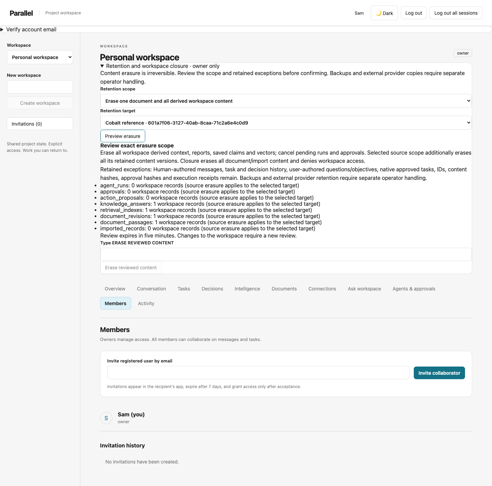

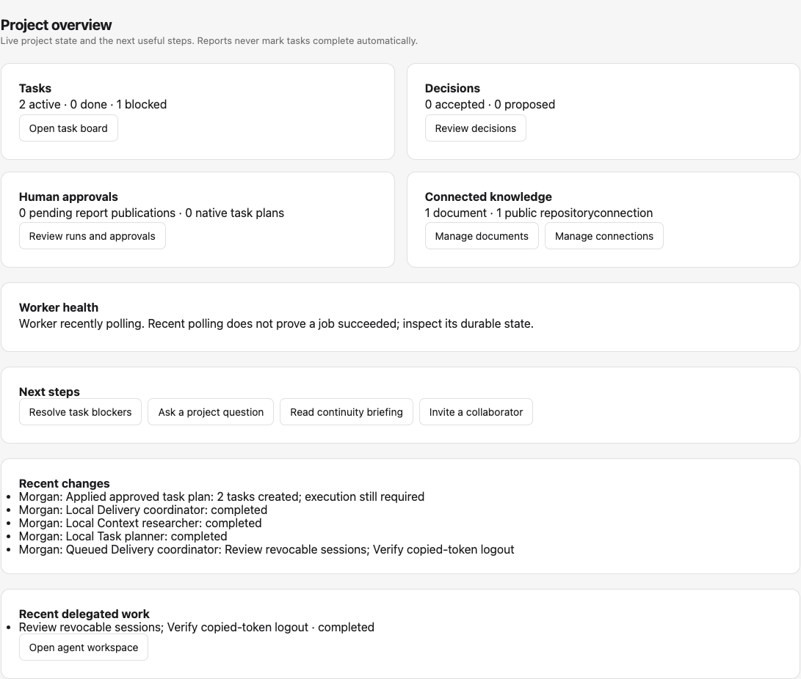

<details>
<summary>Inspect connected knowledge, decisions and verified outcomes</summary>

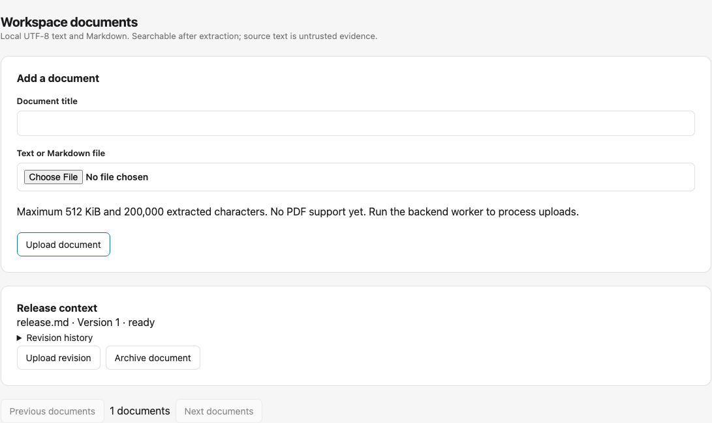
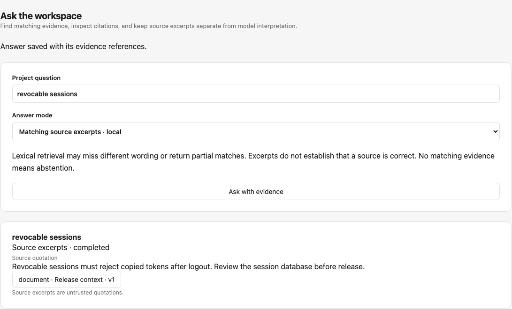
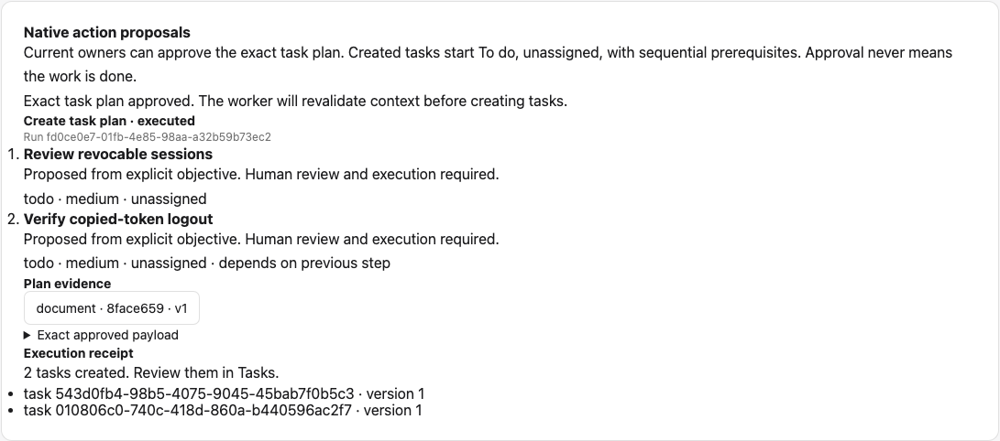

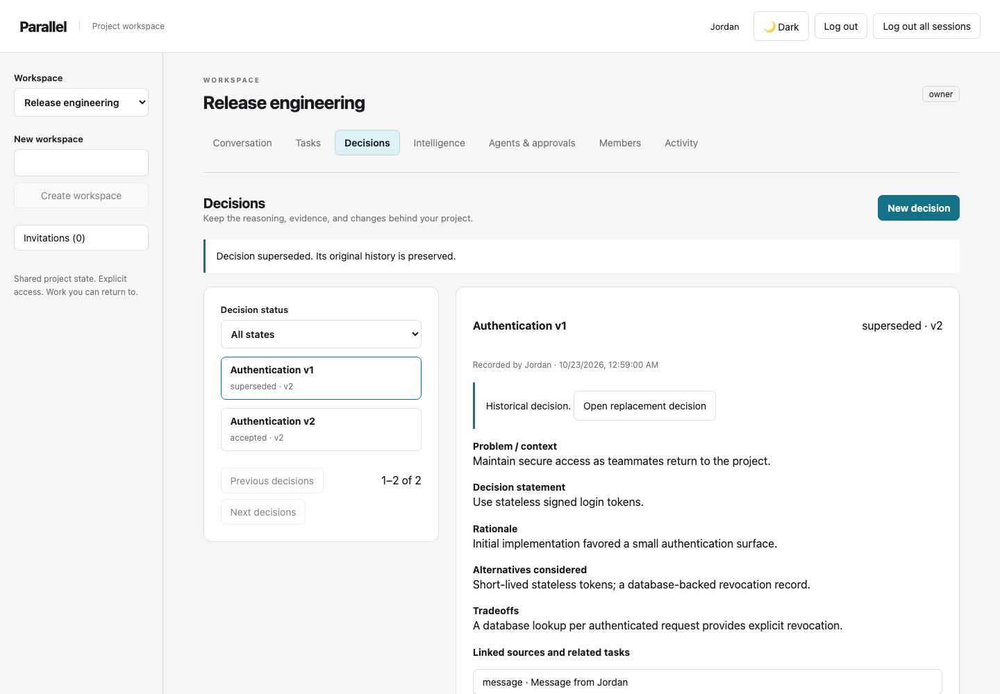
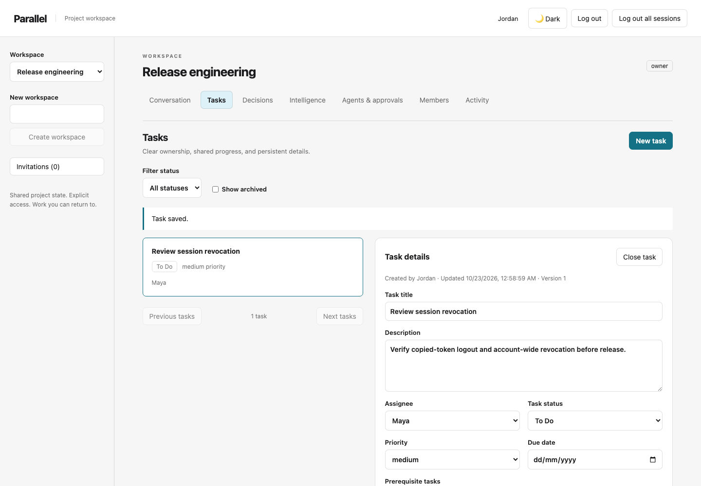
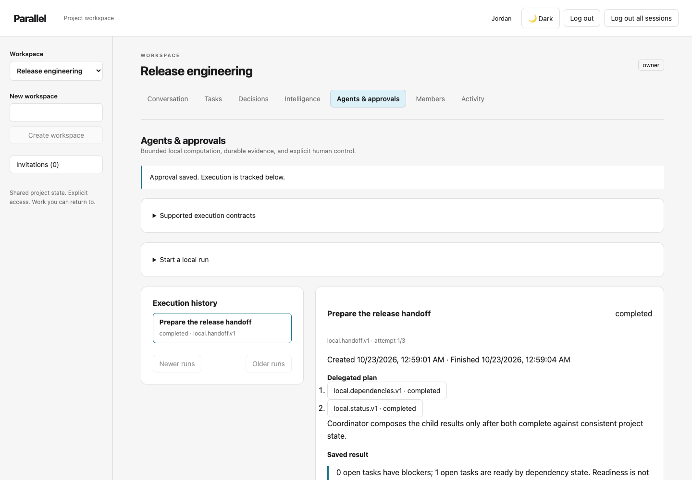
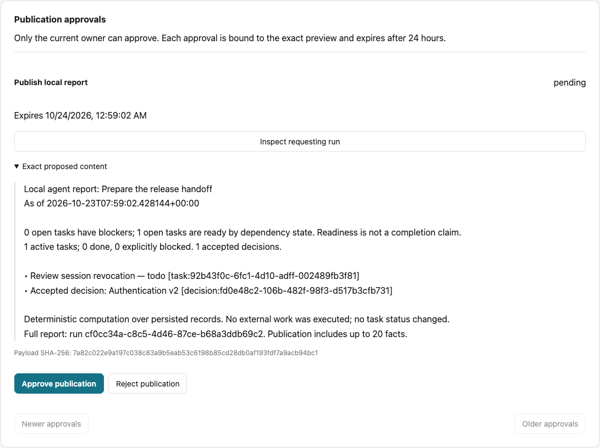

The connected workflow is tested at 390 × 844. [Mobile overview](docs/screenshots/connected-overview-390.png).

</details>

## Why project continuity matters

A conversation can contain conflicting advice. A task can remain blocked after someone posts a confident status update. An architectural choice can be replaced without its original reasoning becoming irrelevant. Reconstructing those details on every return wastes attention and makes AI context unreliable.

Parallel keeps source records, structured team decisions and derived reports separate. Current choices remain distinct from superseded ones. Every report has a stated scope and time, and every approval has a specific proposed action and execution receipt.

## What works today

**Collaborate with explicit access.** Create workspaces, invite registered teammates in app, exchange messages, assign persistent tasks and prerequisites, manage ownership, and revoke sessions. Removal denies subsequent workspace access and unassigns tasks. Invitations do not send email.

**Preserve decisions and evidence.** Record context, statement, rationale, alternatives and tradeoffs. Link actual messages, tasks, activity or decisions. Corrections append revisions; supersession links to a replacement without erasing the old reasoning. Inspect originally cited previews alongside current source state.

**Return to real project state.** Search authorized records with deterministic lexical ranking and status/time filters. Open a continuity briefing for changes since a saved visit or selected timestamp. See decision revisions, task state, prerequisites, activity and pending approvals. Missing evidence is shown explicitly.

**Connect useful context.** Upload UTF-8 text/Markdown or extractable-text PDFs, preserve revisions and stable passages, and archive documents to remove every passage from retrieval. An explicitly enabled public GitHub connector imports a bounded read-only repository/issue/PR snapshot with original links and owner revocation. Ask workspace saves local source excerpts, or separately enabled model interpretation with allowlisted citations and explicit abstention. Changed/revoked evidence hides saved answers and derived reports.

**Coordinate bounded local work.** Status and dependency contracts retain their handoff coordinator. A task planner preserves explicit objective steps; a context researcher retrieves authorized excerpts; a delivery coordinator delegates both and checks consistent context. Inspect child results, timelines, failures and retries. Owners can approve an exact sequential task plan; the worker rechecks context/authority and atomically creates To do tasks with a receipt. Report publication remains a separate approval. Reports never mark tasks Done.

This is a local/team engineering foundation. Extractable PDFs now preserve page citations; an optional GitHub App flow supports selected private repositories with encrypted expiring grants. The shipped optional index uses local character similarity, not a trained semantic model. OCR, general model planning, external writes and production hosting remain unimplemented. Public GitHub reads were live-tested in the previous cycle; private authorization and optional model calls are fixture-tested only. No live private access or paid model-quality verification is claimed.

## Architecture

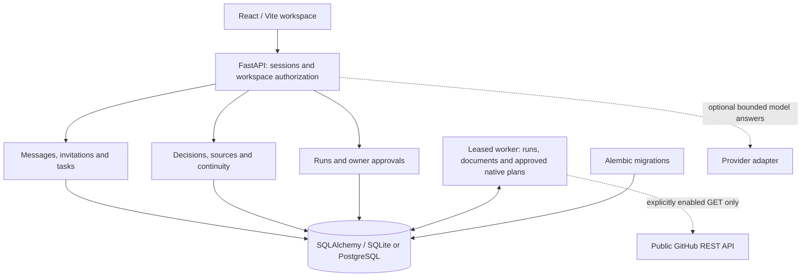

FastAPI domain routers share a workspace mutation lock and backend membership checks. Retrieval is workspace-scoped SQL; source text cannot grant permissions. The separate worker shares the migrated database, performs bounded computation and explicitly authorized repository reads, and rechecks membership, dependencies and its lease before saving results. [Architecture](docs/ARCHITECTURE.md) explains these boundaries; [Data model](docs/DATA_MODEL.md) includes the entity diagram and constraints.

The stack is React 19/Vite, FastAPI, SQLAlchemy/Alembic, bcrypt/PyJWT, SQLite for local development and PostgreSQL 16 in CI. Polling keeps the interface simple. No vector database, external queue or distributed service framework is required. Private credentials use a separate server-side Fernet key; see [configuration](docs/INTEGRATIONS.md).


## Three connected workflows

### Human collaboration

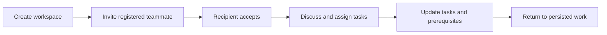

### Project continuity

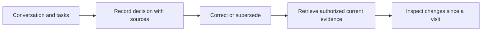

### Durable agent coordination

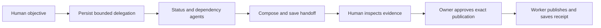

Read-only reports need no publication approval. Selecting publication introduces a checkpoint; approval does not itself execute the action. Cancelled, failed or queued work is never presented as completed. [Agent orchestration](docs/AGENT_ORCHESTRATION.md) describes contracts, state transitions and recovery.

## Quick start: local SQLite

Use Python **3.12 or 3.13** and Node **22.12+**. The UI, search, briefings and local agents require no provider key.

```bash
git clone https://github.com/Yug-More/Parallel-AI.git
cd Parallel-AI/backend
python3.12 -m venv .venv
source .venv/bin/activate
pip install -r requirements-dev.txt
cp .env.example .env
python -c 'import secrets; print("SECRET_KEY", secrets.token_urlsafe(48), sep="=")' >> .env
python migrate.py
uvicorn main:app --host 127.0.0.1 --port 8000
```

In a second terminal:

```bash
cd Parallel-AI/parallel-frontend
npm ci
npm run dev
```

In a third terminal, using the same backend directory and configuration:

```bash
cd Parallel-AI/backend
source .venv/bin/activate
python worker.py
```

Open **http://localhost:5174** and register. Create a workspace and open Overview for next steps. Invite another registered account through Members; use Tasks and Decisions, upload a document, ask a question, then try Delivery coordinator with semicolon-separated task titles. Inspect Native action proposals before approving. The worker must be running for uploads, runs, syncs and approved actions to execute. Workspace/section navigation survives refresh; credentials stay in HttpOnly cookies.

The relative SQLite URL resolves from the backend working directory. Keep frontend/API hostnames consistent for cookies. The Vite port can change if occupied; align `CORS_ORIGINS` with the actual origin. Windows users activate with `.venv\Scripts\Activate.ps1`. See [Development](docs/DEVELOPMENT.md) for settings, troubleshooting, optional PostgreSQL/Docker and provider setup.

**Existing database:** stop HTTP and worker writers, verify a restorable backup, and test a disposable copy before migrating. The current head is `0013_shared_limits`; revisions 0004–0013 preserve existing collaboration records and live session data. Never reset user data or run historical destructive seed instructions.

## Verification

From the repository root with the backend environment active:

```bash
ruff check backend scripts
ruff format --check backend scripts
pytest -q backend/tests
python backend/evaluation/run.py --ranking legacy
python backend/evaluation/run.py --ranking coverage
python backend/evaluation/connected.py
python backend/evaluation/pilot.py
python scripts/check_secrets.py
```

From `parallel-frontend`:

```bash
npm ci
npm run lint
npm run build
npx playwright install chromium
PARALLEL_TEST_PYTHON=../backend/.venv/bin/python npm test
```

Browser tests start disposable real HTTP/database/worker services with separate account contexts on desktop and mobile. They cover collaboration, decision sources/supersession, retrieval, persisted delegated reports, approvals, refresh and access removal. CI also runs Python 3.12/3.13, PostgreSQL fresh/populated upgrades and concurrency, migration drift, dependency audits and the source secret guard. Exact test counts and remote status belong to each PR/run, rather than a permanently stale README badge.

Coverage-based lexical ranking measured precision **0.909** versus the original **0.864**, with unchanged **0.909 recall** on the eleven-query fixture. On sixteen additional frozen author-curated queries, precision rose **0.734 → 0.875** with recall **0.875** unchanged; checked citations and authorization gates passed. English paraphrase and Spanish vocabulary misses remain. [Evaluation](docs/EVALUATION.md) records labels, latency workload, raw results and limitations; these are not independent human judgments, real-user benchmarks or a semantic-search comparison.

The additional 40-query developer-created holdout measured MRR **0.818 → 0.839** for optional phrase/current-state ranking versus coverage, with recall **0.900** and returned-result precision **0.773** unchanged. Coverage remains the default. Strict precision@5, every case and known misses are recorded in [evaluation-pilot.json](docs/evaluation-pilot.json). [Pilot boundaries and walkthrough](docs/PILOT_READINESS.md) distinguish implemented controls from deployment gaps.

## Security and deployment status

Authentication requires both a valid signed cookie and a live unrevoked database session. Owners control membership/ownership and report publication. Source resolution and every intelligence/run/approval endpoint enforce workspace membership. Worker finalization rechecks authority and context; approved publication binds the exact payload and receipt atomically.

There is no production deployment claim. Public release still needs trusted TLS ingress, ingress abuse protection, verification/recovery flows, PostgreSQL restore drills, installed worker supervision, monitoring and retention policies. Shared authentication/model counters, fair queue rotation and an isolated SQLite restore drill are implemented. Historical Plivo credential exposure remains an **owner-side revocation/rotation action**; removing source text did not revoke it. See [Security](docs/SECURITY.md).

## Documentation

- [Product vision and scope](docs/PRODUCT_VISION.md)
- [System architecture and authorization flow](docs/ARCHITECTURE.md)
- [Entities, constraints and migration preservation](docs/DATA_MODEL.md)
- [Decision provenance, retrieval and continuity](docs/PROJECT_CONTINUITY.md)
- [Agent contracts, approvals and recovery](docs/AGENT_ORCHESTRATION.md)
- [Retrieval evaluation and measured limitations](docs/EVALUATION.md)
- [PDFs, public/private GitHub and grounded-answer boundaries](docs/INTEGRATIONS.md)
- [Readiness, logs, backup and recovery](docs/OPERATIONS.md)
- [Engineering decisions and alternatives](docs/ENGINEERING_DECISIONS.md)
- [Development, migration and verification commands](docs/DEVELOPMENT.md)
- [Security boundaries and remaining risks](docs/SECURITY.md)
- [Roadmap](docs/DEVELOPMENT_ROADMAP.md) · [Audit history](docs/REPOSITORY_AUDIT.md) · [Engineering instructions](AGENTS.md)

## History, contributions and licensing

Parallel began as a hackathon project. The project owner's supplied history records recognition at the **Global Scoop AI Hackathon** and **Continual Learning Hackathon**, with approximately **$20,000 combined awards**. That recognition concerns the original work, not the later Phase 1–6 implementation or a production deployment. Historical commits and human contributors are preserved.

Contributors should follow [AGENTS.md](AGENTS.md), use focused PRs with actual verification evidence, and preserve data and authorization boundaries. This repository contains **no license granting redistribution**; no new license or legal permission is implied by public source visibility.
