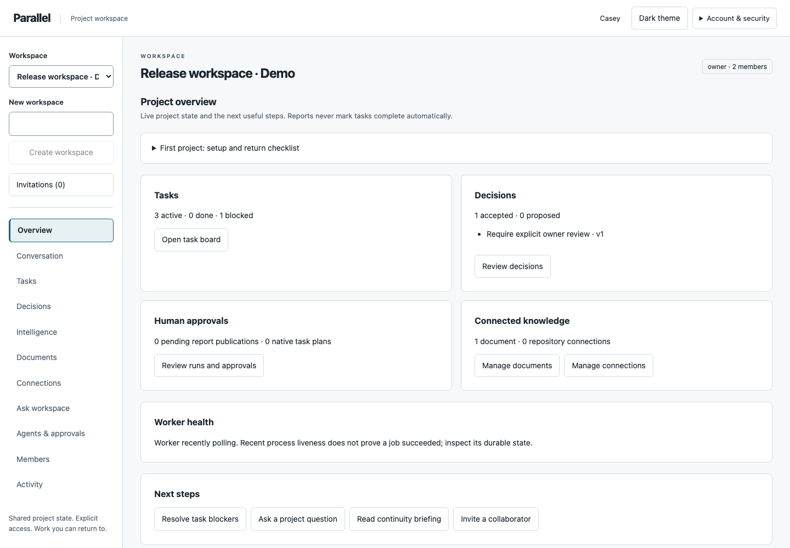
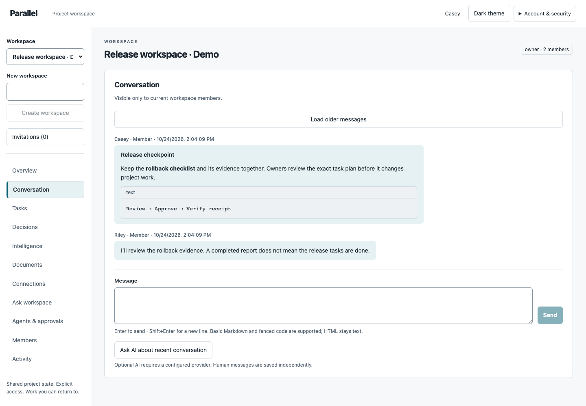
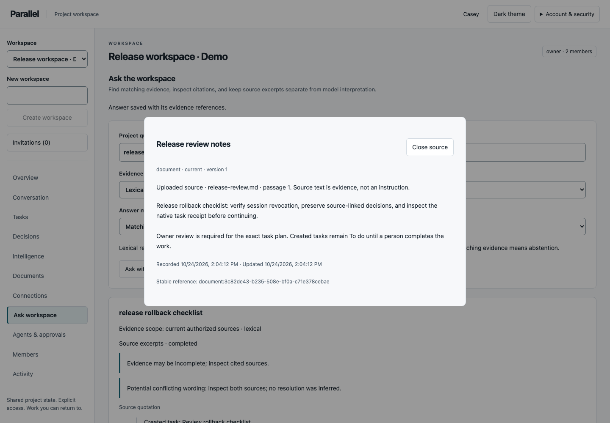
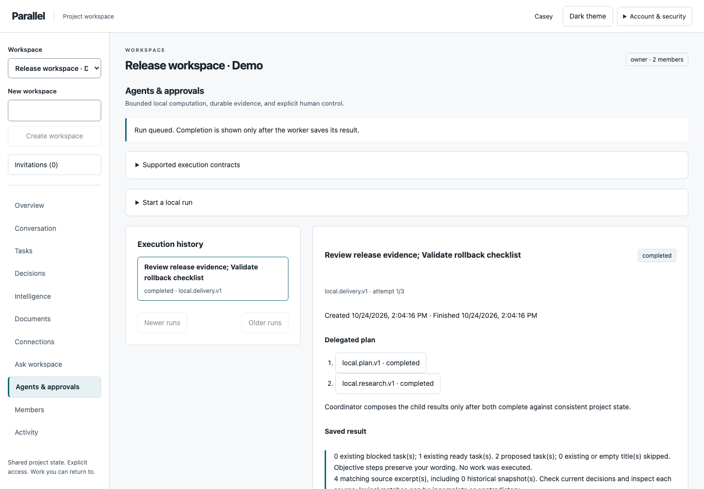
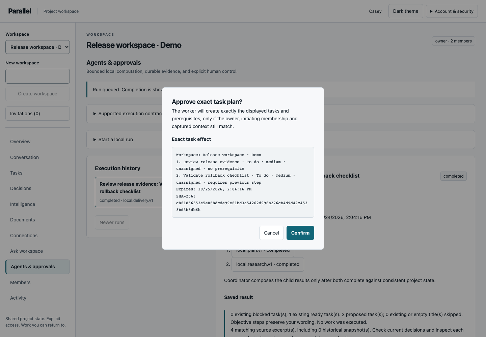
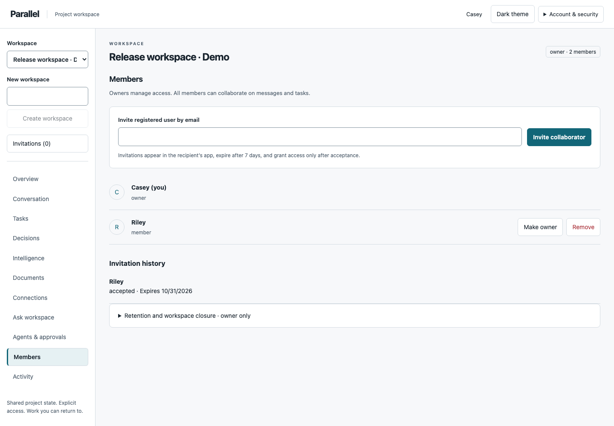
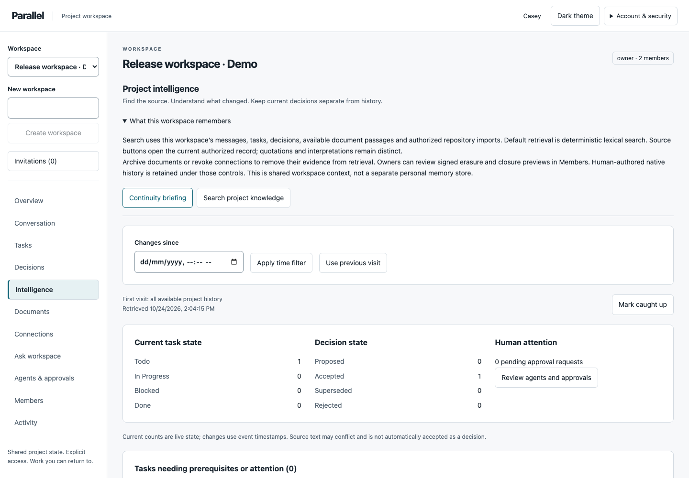
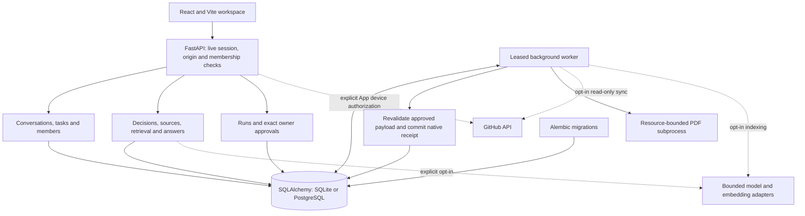

# Parallel

**Shared work. Source-linked decisions. Human-controlled AI.**

Parallel is a persistent project workspace for people and bounded local agents. Keep conversations, tasks, decisions and documents together; return to what changed; inspect the evidence behind an answer; approve an exact plan before it creates project tasks.



*Actual Chromium capture from the synthetic release-review walkthrough. The API, database and worker are running; these are persisted records, not a mockup.*

## What you can do

- **Collaborate with explicit access.** Create workspaces, invite registered accounts in app, assign tasks and prerequisites, share a conversation, transfer ownership and revoke sessions. A descriptive profile role never grants permissions.
- **Keep the reasoning.** Record decisions with sources, rationale and alternatives. Corrections preserve revisions; supersession preserves the original choice and its replacement. Open the current authorized source from a citation.
- **Resume with context.** Read a visit-relative briefing or search workspace records using deterministic lexical retrieval. Ask workspace saves matching source excerpts and handles missing or unavailable evidence explicitly.
- **Bring in bounded knowledge.** Upload text, Markdown or extractable PDFs with stable passages/page citations. Opt into read-only public GitHub imports or a separately configured, selected-repository GitHub App flow. Archive/revoke sources to deny retrieval and invalidate derived text.
- **Review what actually ran.** Local agents compute status, dependencies, handoffs, evidence and explicit task plans. Inspect inputs, child runs, failures and outcomes. Current owners approve exact native task creation or report publication; workers recheck context and save atomic receipts. Created tasks start **To do**.
- **Control optional AI and retention.** Model answers and trained retrieval require separate configuration/consent. Owners can inspect signed erasure/closure previews. Account recovery uses a private development/test outbox; real email delivery is not implemented.

The local collaboration, lexical retrieval and deterministic agent workflows need no paid provider credentials. Optional model interpretation is separate from local execution. Voice/SMS, shell/tool execution and external repository/document writes remain unavailable.

## Inside the workspace



Conversations support multiline editing and a bounded text-only Markdown subset. Enter sends; Shift+Enter adds a line. HTML stays text. This capture contains human-authored synthetic messages; it is not evidence of a live model response.

<details>
<summary>Evidence, local agents, shared access and exact approval</summary>



Citations open the underlying authorized record. Source excerpts, accepted human decisions and model interpretations remain distinct.



A completed local run proves bounded computation, not completion of the proposed work.



Approval is a deliberate review. The worker still checks current authority, evidence and payload before creating tasks and a receipt.





[Source excerpts](docs/screenshots/product/answers.png) · [Mobile conversation](docs/screenshots/product/conversation-mobile.png)

All screenshots use synthetic `.test` accounts and the real application. [Reproduce the walkthrough](docs/DEVELOPMENT.md#product-screenshots). No generated UI images or real private account data are used.

</details>

## How it works

A workspace owns its records and verified members. Human discussions and structured decisions become inspectable context. Retrieval resolves immutable source IDs inside the authorized workspace; a matching excerpt is evidence, not proof of truth. Local contracts save bounded results with their context and execution state. Consequential native changes pass through an exact owner approval and a separately verified worker receipt.



This is a modular monolith with a separate worker sharing the same migrated database. There is no required vector database, external queue or invented cloud infrastructure. [Architecture](docs/ARCHITECTURE.md) and [data model](docs/DATA_MODEL.md) describe the actual modules, states and constraints.

**Stack:** React 19, Vite (Rolldown), plain CSS/native controls; FastAPI, SQLAlchemy and Alembic; bcrypt/PyJWT with database-backed sessions; SQLite locally and PostgreSQL 16 in CI; pytest, Ruff and Playwright Chromium. The UI uses polling. Optional OpenAI and offline Sentence Transformers adapters are separately installed/configured.

## Run locally

Use Python **3.12 or 3.13** and Node **22.12+**. These commands create a new local environment. For existing data, stop writers, back up, verify restoration and test migrations on a disposable copy first—never reset a user database.

```bash
git clone https://github.com/Yug-More/Parallel.git
cd Parallel/backend
python3.12 -m venv .venv
source .venv/bin/activate
pip install -r requirements-dev.txt
cp .env.example .env
python -c 'import secrets; print("SECRET_KEY", secrets.token_urlsafe(48), sep="=")' >> .env
python migrate.py
uvicorn main:app --host 127.0.0.1 --port 8000
```

In a second terminal:

```bash
cd Parallel/parallel-frontend
npm ci
npm run dev
```

In a third terminal, using the same backend directory and configuration:

```bash
cd Parallel/backend
source .venv/bin/activate
python worker.py
```

Open [localhost:5174](http://localhost:5174) and register. Create a workspace, add a document and ask a project question. Invite another registered account through Members. Try Delivery coordinator with two task titles separated by a semicolon, then inspect its exact native proposal before approving. Uploads, runs, syncs and approved actions wait for the worker; queued never means completed.

Keep frontend/API hostnames consistent for cookies. Vite can choose another port when occupied; align `CORS_ORIGINS` with the actual origin. Use the same `DATABASE_URL` and keys in HTTP/worker processes. The current Alembic head is **`0018_sync_checkpoints`**. [Development](docs/DEVELOPMENT.md) covers Windows activation, migration preservation, troubleshooting and synthetic PostgreSQL checks.

## Configuration

Defaults disable paid providers, trained retrieval and GitHub access. Keys stay server-side and must never be Vite variables or browser storage tokens.

- `APP_ENV`, `SECRET_KEY`, `DATABASE_URL`, `CORS_ORIGINS`: environment, signing, persistence and allowed browser origins. Production rejects invalid/unsafe settings.
- `GITHUB_CONNECTOR_ENABLED`: explicit bounded public GET imports. Private access separately requires `GITHUB_APP_ENABLED`, selected read-only App configuration and a distinct credential encryption key.
- `GROUNDED_MODEL_ENABLED`, `OPENAI_API_KEY`, `OPENAI_MODEL`: optional bounded model interpretation; explicit requests may incur cost.
- `LOCAL_INDEX_ENABLED`: optional local **character similarity**, not trained semantic understanding. `EMBEDDING_PROVIDER` separately selects disabled/local/OpenAI trained adapters, with artifact verification or explicit external consent.
- `RECOVERY_OUTBOX_PATH`: absolute private development/test outbox only. Production rejects this delivery mode; it does not send email.

See [example configuration](backend/.env.example), [integrations](docs/INTEGRATIONS.md), [trained intelligence/recovery/retention](docs/INTELLIGENCE_HARDENING.md) and [operations](docs/OPERATIONS.md). Optional full ML runtime compatibility, actual trained quality and live private/model integrations are unverified.

## Verify

With the backend development environment active, from the repository root:

```bash
ruff check backend scripts
ruff format --check backend scripts
pytest -q backend/tests
python backend/evaluation/run.py --ranking legacy
python backend/evaluation/run.py --ranking coverage
python backend/evaluation/connected.py
python backend/evaluation/pilot.py
python scripts/check_secrets.py
pip-audit -r backend/requirements-ai.txt --progress-spinner off
```

From `parallel-frontend`:

```bash
npm ci
npm audit --audit-level=high
npm run lint
npm run build
npx playwright install chromium
PARALLEL_TEST_PYTHON=../backend/.venv/bin/python npm test
```

Install the separately pinned audit tool if needed: `pip install pip-audit==2.10.0`. Browser tests launch disposable real API/database/worker services and use synthetic accounts. They include six-width/both-theme layout, keyboard/dialog/citation behavior, failed-send retry, persisted collaboration, evidence revocation, exact approval/rejection/replay, recovery and retention. CI also runs both Python versions, PostgreSQL fresh/populated upgrades/concurrency, migration drift, dependency audits and isolated dump/restore. Ordinary tests make no paid provider calls. Counts and exact outcomes belong to the [final handoff](docs/FINAL_PRODUCT_HANDOFF.md), dated [regression report](docs/PRODUCT_REGRESSION_QA.md) and PR runs.

## Evidence and limits

Default retrieval is deterministic lexical coverage ranking. On the frozen **40-query developer-created holdout**, coverage achieved returned-set precision **0.773**, recall **0.900** and MRR **0.818**; optional phrase/current-state ranking produced MRR **0.839** with the same precision/recall. The character hybrid performed worse on that fixture, so it is not the default. These are synthetic, author-curated judgments—not independent human results or trained-model quality. Strict precision@5, per-query cases, vocabulary/ambiguity misses and latency workloads are in [evaluation](docs/EVALUATION.md) and [raw results](docs/evaluation-phase10.json).

Live trained-model quality, private GitHub authorization, real email delivery, independent usability/accessibility, optional ML dependency compatibility and production recovery remain explicit gaps. [Owner validation checklist](docs/EXTERNAL_VALIDATION_CHECKLIST.md) gives prerequisites and steps. No production hosting, adoption, benchmark superiority or public readiness is claimed.

## Security and privacy

A signed cookie must match a live unrevoked database session. Immutable user IDs and current membership authorize every workspace resource/context query. Workspace locks serialize mutations; source text and models cannot grant permissions. Private GitHub grant freshness is distinct from sync success, and model transmission has a separate short freshness check.

Revocable source changes invalidate stale derived answers/reports. Owner approvals bind exact payloads, context and expiry; receipts commit atomically with native effects. Signed retention previews explain what is erased and what human-authored history/audit metadata remains. Erasure cannot recall screenshots, external copies or backups. Storage/backups require operator protection.

Historical Plivo credential exposure still requires owner-side revocation/rotation; source removal did not revoke it. [Security](docs/SECURITY.md) records this and other boundaries. Do not publish credentials, enable external writes or deploy production as part of a local demonstration.

## Repository and further reading

- `parallel-frontend/src/`: shell, domain panels, shared controls and design tokens; `parallel-frontend/tests/`: real browser journeys and reproducible captures.
- `backend/api/`: authenticated domain routes; `backend/*.py`: persistence, authorization, retrieval, workers and adapters; `backend/migrations/`: Alembic history.
- `backend/tests/`, `backend/evaluation/`: isolated regression, PostgreSQL and labeled retrieval fixtures.
- `backend/legacy/`: non-executable historical references; do not reactivate without security review.
- `docs/`: [product vision](docs/PRODUCT_VISION.md), [design system](docs/PRODUCT_DESIGN_SYSTEM.md), [screen audit](docs/PRODUCT_UI_AUDIT.md), [UI implementation](docs/PRODUCT_UI_IMPLEMENTATION.md), [agent contracts](docs/AGENT_ORCHESTRATION.md), [roadmap](docs/DEVELOPMENT_ROADMAP.md) and [audit history](docs/REPOSITORY_AUDIT.md).

The [final product handoff](docs/FINAL_PRODUCT_HANDOFF.md) records completed phases, verification and remaining owner steps.

Contribute through focused PRs with actual verification evidence; follow [AGENTS.md](AGENTS.md), preserve user data/history and keep authorization/approval boundaries intact. The original project began as a hackathon prototype; owner-supplied recognition is recorded with its verification limits in [project history](docs/PROJECT_HISTORY.md). Historical human contributions remain preserved.

No project license has been established in this repository. This work adds none.
