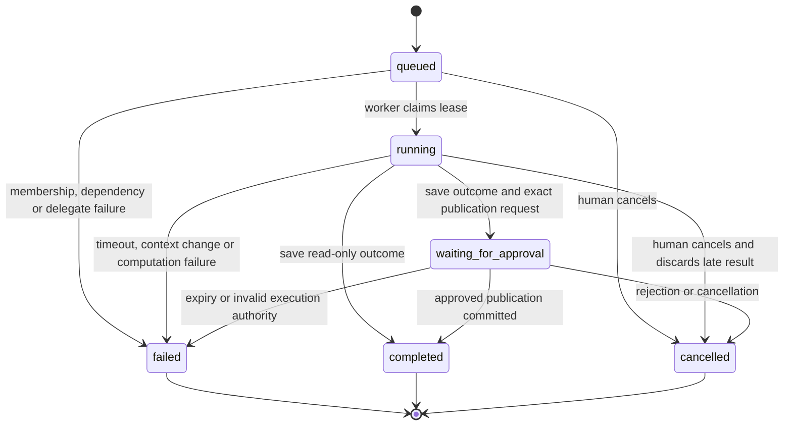
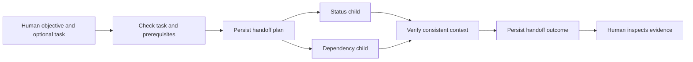
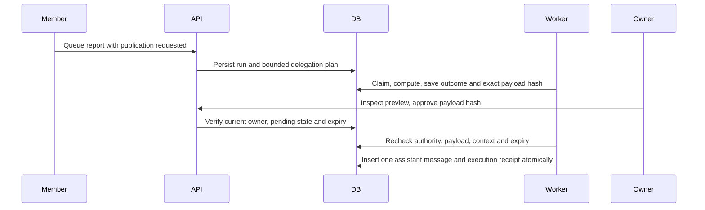

# Durable local agent coordination

The supported agents perform real deterministic computation over persisted workspace data. They do not execute code, browse, call models, modify external systems, or implement a task on a user's behalf.

## Contracts

`GET /agent-contracts` describes the three versioned identities:

- **`local.status.v1`** counts active task states, records task facts and accepted decisions with source IDs, and saves a status report.
- **`local.dependencies.v1`** traverses prerequisite chains, identifies unfinished prerequisites and explicit Blocked states, and lists work ready by dependency state. It can analyze a blocked task.
- **`local.handoff.v1`** is a coordinator: its persisted plan delegates to the status and dependency contracts, waits for both child outcomes, verifies context fingerprints and composes a handoff. The child runs have distinct computation and inspectable outcomes.

An objective is a human label, not executable instructions. Explicit input references are resolved in the same workspace and retained in the context snapshot. Their text cannot expand capabilities or grant permissions. Publication is a separate local action.

## Run lifecycle



### Queue and delegation

`POST /workspaces/{w}/runs` accepts a known `agent_type`, objective (up to 1,000 characters), optional task, up to 30 `input_refs`, a `publish` flag, and `idempotency_key` (8–100 characters). Repeating the same key and payload returns the same run; changing the payload with that key returns 409. Keys are unique per workspace and initiator. The UI preserves a request key across a failed response retry.

The coordinator creates two queued children and records its plan atomically. Children run before composition; completion is never inferred from queue insertion. Child failures/cancellation fail the coordinator. Delegation is fixed and bounded, with no user-defined graph or recursive agent chain.



A task-associated status/handoff run requires an active unfinished task that is not explicitly blocked and whose prerequisites are Done. Dependency analysis may inspect blocked work. The worker checks again before computing and before committing. A task change during computation invalidates the result. Reports never change task status, assignment, or decision acceptance.

### Worker operation and recovery

Start a third development terminal with the same database configuration as the HTTP backend:

```bash
cd backend
source .venv/bin/activate
python worker.py
# For one job, recovery or approval only:
python worker.py --once
```

The worker checks the schema; it does not migrate automatically. No queue service is required. Multiple processes may share PostgreSQL/SQLite; workspace locks and lease tokens prevent duplicate claims and late commits. No deployment scheduler is bundled. A stopped worker leaves durable queued work visible until a worker starts.

Each claim stores a random lease token, context and 60-second lease in a short transaction. Computation runs outside it. Completion rechecks membership, task validity, source/task/decision fingerprint, and token. Dependency traversal has a 30-second computation budget, a 100-node path bound and bounded output. Finalization refuses an expired lease even if computation returned.

A restarted worker marks expired Running jobs Failed (`lease_expired`). It never guesses that they succeeded. Waiting approvals expire after 24 hours and are materialized by the worker or an attempted response. There are no automatic retries. The original initiator may explicitly retry a failed root/standalone run at most twice (three total attempts); each retry is a new durable run, and each failed record permits only one successor retry. Cancelled/completed runs are not retried.

Cancellation is available to the initiator/current owner and cancels pending children and approvals. Completed child reports remain historical records. A late worker discards its result when cancellation/recovery has already won.

### Bounds and staleness

A workspace may have at most 100 outstanding run records (including children; a handoff needs three available slots). The worker snapshots at most 500 total tasks, 200 accepted decisions, 2,500 dependency edges and the explicit source references. It fails with `scope_limit_exceeded` rather than claiming a complete report over a truncated graph. The UI's task/prerequisite selectors offer bounded recent candidates; APIs accept any authorized eligible task.

Fingerprints include task versions, status, assignment, archival, accepted decisions, dependency edges and explicit source text. Related changes require a new run/retry. Child and parent fingerprints must match; ongoing editing can intentionally cause `context_changed`. Outcomes are historical as-of snapshots, not perpetually current truth. Unlinked conversation text is outside these contracts' computation scope.

## Approval and exact publication



A successful computation with `publish=true` enters Waiting for approval. It does not publish yet. The server constructs a preview containing the objective, report time/summary, up to 20 facts with bounded citations, and the full run reference. The owner must submit its SHA-256 to approve/reject; the frontend asks for confirmation. Approval records bind `publish_report`, workspace, run, agent identity and exact content. No client-provided replacement action is accepted.

Approval alone is not an execution receipt. A worker revalidates the requester is still a member, the approver is still owner, expiry, payload hash/equality and project fingerprint. It writes one assistant message plus Executed state/message ID and run completion in one transaction. Competing workers cannot duplicate publication. Ownership transfer or membership removal can invalidate an earlier approval. Rejection cancels publication while preserving the computed report. Expired or mismatched approvals fail with visible error codes.

The requesting user's logout does not cancel already authorized durable work; membership revocation and explicit cancellation do. Session revocation still denies all subsequent protected API access. No approval can authorize external writes.

## Observability and limits

`GET /runs`, `/runs/{id}`, and `/approvals` are workspace-authorized and bounded. Run detail includes the objective, initiating ID, source snapshot/scope, plan/children, timeline, outcome, error code, attempt chain and approval. Worker exceptions become safe public codes; raw provider/exception payloads are not stored or exposed. Events are append-only through application APIs, not tamper-proof against administrators.

Not implemented: LLM agent execution, external integrations, arbitrary tools, dynamic delegation graphs, distributed queue infrastructure, automatic compensation, durable streaming, or production monitoring. These need separate capability and approval designs.
