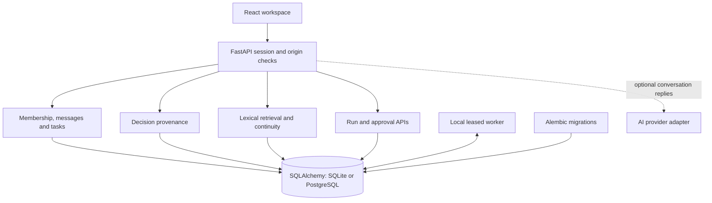
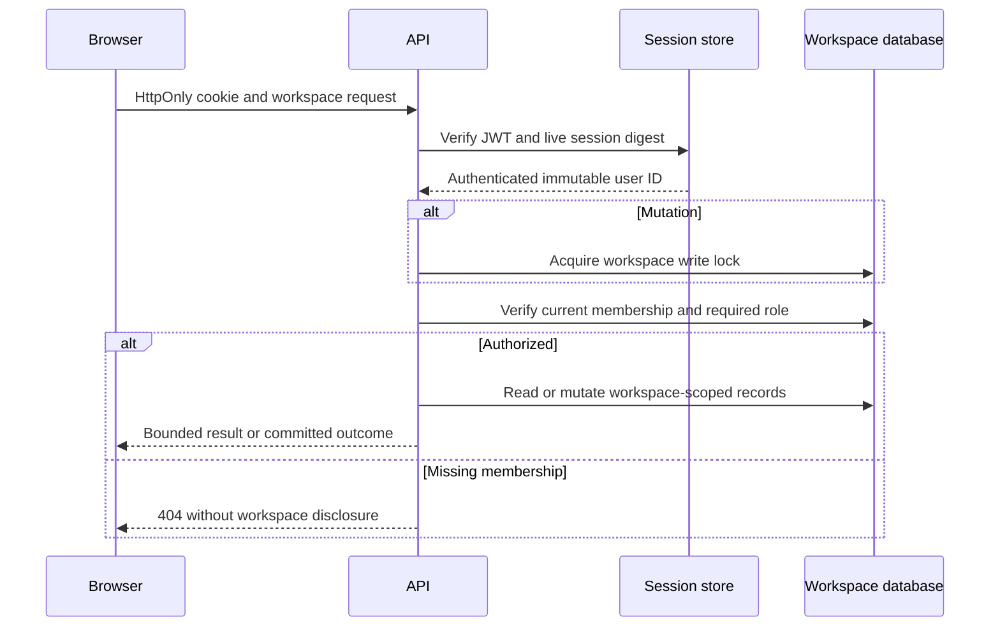
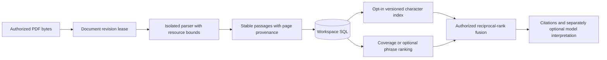
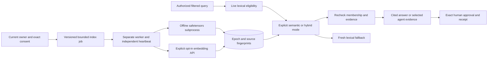
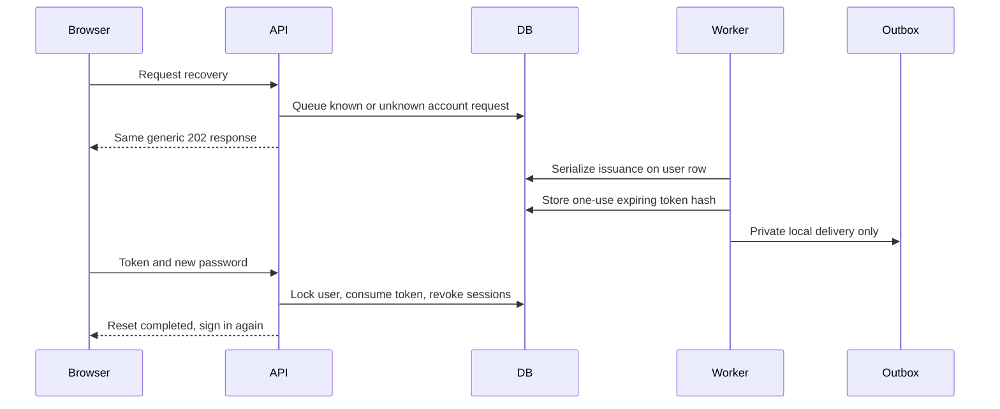
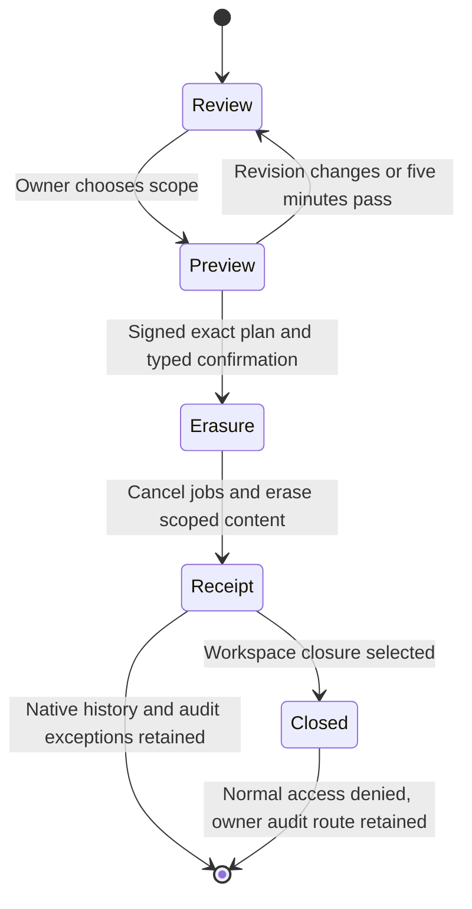

# Architecture

Parallel is a modular monolith with a separate local worker process sharing the same database. React/Vite renders the workspace; FastAPI exposes authenticated domain APIs. SQLAlchemy handles persistence and Alembic owns schema evolution. SQLite is the local default; PostgreSQL 16 is the shared-database CI target.

## Modules and boundaries

- `main.py` composes routers, settings, session factory, origin checks, no-store responses and startup schema verification. Importing models never opens a database.
- `security.py` handles HttpOnly JWT cookies backed by live revocable session records, password hashing, input validation, UTC serialization and membership checks.
- `collaboration.py` is the workspace mutation serialization boundary. An UPDATE acquires the PostgreSQL row/SQLite writer lock before checking membership, preventing removal races from authorizing later writes.
- `api/workspaces.py`, `invitations.py`, `messages.py`, and `tasks.py` retain Phase 1B collaboration. Task versions reject lost updates; dependencies are a small SQL graph.
- `api/decisions.py` and `provenance.py` preserve revisioned human decisions and resolve actual same-workspace evidence.
- `retrieval.py` builds bounded SQL union queries over current sources. `api/intelligence.py` authorizes retrieval and builds visit-relative briefings.
- `api/agents.py` exposes human control; `orchestration.py` owns contract execution, context capture, leases, composition, recovery and exact publication. `worker.py` is its process entry point.
- `providers.py` provides optional conversation replies and separately enabled structured grounded answers. Local deterministic agent contracts never call it. Historical voice/SMS/tool modules remain non-executable under `legacy/`.

## Workspace authorization

Owners manage invitations/removal/ownership, authorize/revoke public repository reads, and approve publications/native task plans. All members can collaborate on tasks and decisions, retrieve sources, and request read-only local runs. Only the initiating member or owner can cancel a root run; only the original initiator retries failed work. Agent identities are stable capability identifiers, not membership roles. Source text, display names, URL parameters and model output never confer authority.

Read operations check membership before querying workspace resources. An already-authorized in-flight read may finish during removal; subsequent requests are denied. Frontend polling clears inaccessible state. A worker independently rechecks authority before saving an outcome or executing approved publication.

## Transaction and execution flow

Decision edits, supersession, invitation transitions, task updates and approvals acquire the same workspace lock and commit activity with the mutation. All resource IDs are scoped in queries; composite foreign keys back relationships where possible. Polymorphic source targets are resolved by application code under the lock.

Workers take short claim/finalization transactions, compute outside the lock, and reject changed fingerprints or leases. Report publication, message insertion, approval receipt and run completion share one transaction. Coordinator delegation has exactly two computational children; there is no distributed queue or arbitrary agent fan-out.

Polling remains the transport: approximately two seconds for workspace data, 1.5 seconds for run/approval views. The URL retains workspace and section on refresh while authorization is checked independently. Form drafts are kept separate from polling data. Source dialogs fetch current evidence; decision history retains cited snapshots.

## Data and time

[Data model](DATA_MODEL.md) describes decision/run provenance from `0004_intelligence` and the document/import/answer/action/heartbeat additions through `0013_shared_limits`. Existing Phase 1B records and session validity are preserved. Decisions have full revisions; task history before/after this phase is represented by versions, current state and activity rather than a complete point-in-time task ledger. Briefing event time is distinct from retrieval time; live counts are not historical reconstruction.

## Deployment assumptions and tradeoffs

Development uses one backend, one worker and a database. The worker must be started explicitly; queued jobs survive its absence. Multiple workers are safe under database locks but do not imply a production queue service or measured scaling. SQLite serializes writers; PostgreSQL is the practical shared deployment option. Database backups, TLS, trusted ingress, shared rate limiting, monitoring, resource/retention policies and operational recovery remain deployment work.

Optional providers require separate installation/configuration and can incur cost. Public GitHub GETs were live-verified. Live model compatibility, production deployment, external writes and semantic retrieval are not verified. See [Engineering decisions](ENGINEERING_DECISIONS.md) for why these boundaries were chosen.

## Connected knowledge and native actions

`documents.py` extracts bounded UTF-8 uploads through durable leases; `repositories.py` is a fixed-host public GET adapter and sync worker. `knowledge_sources.py` resolves native/document/import/revision evidence. Search remains SQL-based with a measured term-coverage filter, rather than a new vector/index service. `answers.py` validates schema/citation allowlists and revalidates saved evidence on every read. Optional provider latency runs outside workspace transactions.

Knowledge epochs conservatively invalidate derived run contexts, outcomes, publication previews and generated messages after document/import changes or revocation. Unavailable generated-message previews are redacted from decision source history. Human-authored native records remain authored data. No archive/history flag bypasses a document/connection revocation boundary.

`actions.py` separately executes exact native task-plan proposals; the legacy publish_report approval constraint remains unchanged. The worker recomputes the plan, compares context/payload/hash, verifies current ownership and initiating membership, then commits the complete task graph and resource receipt atomically. Local plan completion means computation completed; the proposed work is still To do. Worker health/readiness/backup behavior and scheduling limits are documented in [Operations](OPERATIONS.md).

## Pilot knowledge and authorization boundaries

New PDF passages use the same document/revision lifecycle plus nullable page numbers. The worker launches a resource-bounded parser subprocess; no new service is required. Optional retrieval-index jobs store provider/model/epoch and fingerprinted vectors in SQL, with explicit lexical fallback. The shipped provider is local character similarity rather than a trained semantic model.

GitHub App device flow binds an expiring encrypted user grant to the current workspace owner and a verified selected repository/installation. Fixed-host authentication POSTs are separate from GET-only repository reads. Revalidation/expiry advances the existing knowledge epoch. Private refresh rotation is persisted before further network reads. A five-minute worker sync schedule and ten-minute authorization freshness window are explicit limits, not a remote webhook guarantee.

Agent issue triage remains inside the existing plan/research/delivery contracts; it proposes unfinished native tasks from stored open issue evidence. Separate issues acquire no inferred dependency. Exact approval/recomputation/receipt boundaries remain unchanged. Optional run reasoning reuses the cited-answer provider and cannot control the action executor. Shared HMAC request counters and rotating worker queues strengthen local operation without introducing distributed infrastructure.

## Phase 10–12 boundaries

See [trained intelligence and hardening](INTELLIGENCE_HARDENING.md) for exact limits, retention exceptions and live verification status. New migrations 0014–0018 are additive; they do not erase history or implicitly verify users. Back up original databases before operator-run migration.

