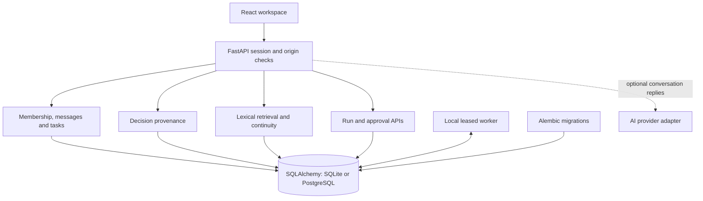
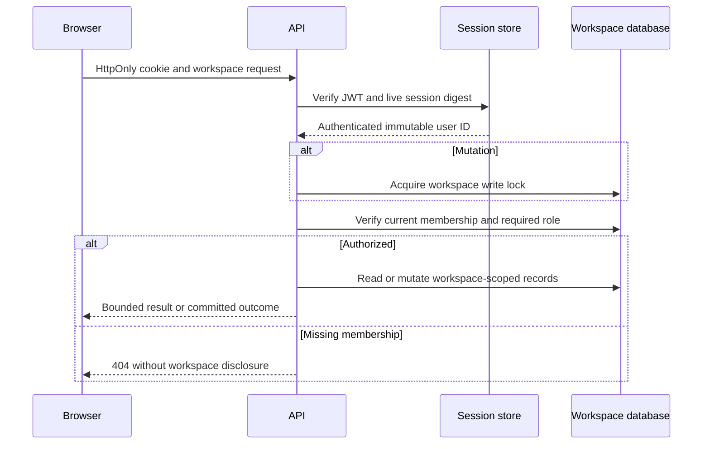

# Architecture

Parallel is a modular monolith with a separate local worker process sharing the same database. React/Vite renders the workspace; FastAPI exposes authenticated domain APIs. SQLAlchemy handles persistence and Alembic owns schema evolution. SQLite is the local default; PostgreSQL 16 is the shared-database CI target.

## Modules and boundaries

- `main.py` composes routers, settings, session factory, origin checks, no-store responses and startup schema verification. Importing models never opens a database.
- `security.py` handles HttpOnly JWT cookies backed by live revocable session records, password hashing, input validation, UTC serialization and membership checks.
- `collaboration.py` is the workspace mutation serialization boundary. An UPDATE acquires the PostgreSQL row/SQLite writer lock before checking membership, preventing removal races from authorizing later writes.
- `api/workspaces.py`, `invitations.py`, `messages.py`, and `tasks.py` retain Phase 1B collaboration. Task versions reject lost updates; dependencies are a small SQL graph.
- `api/decisions.py` and `provenance.py` preserve revisioned human decisions and resolve actual same-workspace evidence.
- `retrieval.py` builds bounded SQL union queries over current sources. `api/intelligence.py` authorizes retrieval and builds visit-relative briefings.
- `api/agents.py` exposes human control; `orchestration.py` owns contract execution, context capture, leases, composition, recovery and exact publication. `worker.py` is its process entry point.
- `providers.py` remains an optional conversation adapter. New local intelligence/agent capabilities never call it. Historical voice/SMS/tool modules remain non-executable under `legacy/`.

## Workspace authorization

Owners manage invitations/removal/ownership and approve publications. All members can collaborate on tasks and decisions, retrieve sources, and request read-only local runs. Only the initiating member or owner can cancel a root run; only the original initiator retries failed work. Agent identities are stable capability identifiers, not membership roles. Source text, display names, URL parameters and model output never confer authority.

Read operations check membership before querying workspace resources. An already-authorized in-flight read may finish during removal; subsequent requests are denied. Frontend polling clears inaccessible state. A worker independently rechecks authority before saving an outcome or executing approved publication.

## Transaction and execution flow

Decision edits, supersession, invitation transitions, task updates and approvals acquire the same workspace lock and commit activity with the mutation. All resource IDs are scoped in queries; composite foreign keys back relationships where possible. Polymorphic source targets are resolved by application code under the lock.

Workers take short claim/finalization transactions, compute outside the lock, and reject changed fingerprints or leases. Report publication, message insertion, approval receipt and run completion share one transaction. Coordinator delegation has exactly two computational children; there is no distributed queue or arbitrary agent fan-out.

Polling remains the transport: approximately two seconds for workspace data, 1.5 seconds for run/approval views. The URL retains workspace and section on refresh while authorization is checked independently. Form drafts are kept separate from polling data. Source dialogs fetch current evidence; decision history retains cited snapshots.

## Data and time

[Data model](DATA_MODEL.md) describes seven new tables added in revision `0004_intelligence`. Existing Phase 1B records and session validity are preserved. Decisions have full revisions; task history before/after this phase is represented by versions, current state and activity rather than a complete point-in-time task ledger. Briefing event time is distinct from retrieval time; live counts are not historical reconstruction.

## Deployment assumptions and tradeoffs

Development uses one backend, one worker and a database. The worker must be started explicitly; queued jobs survive its absence. Multiple workers are safe under database locks but do not imply a production queue service or measured scaling. SQLite serializes writers; PostgreSQL is the practical shared deployment option. Database backups, TLS, trusted ingress, shared rate limiting, monitoring, resource/retention policies and operational recovery remain deployment work.

Optional providers require separate installation/configuration and can incur cost. Live provider compatibility, production deployment, real external actions and semantic retrieval have not been verified in this phase. See [Engineering decisions](ENGINEERING_DECISIONS.md) for why these boundaries were chosen.
