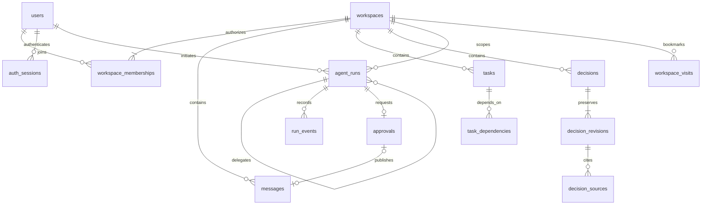

# Data model

All domain data belongs to a workspace. SQLAlchemy models are in `backend/models.py`; Alembic revisions are the only schema-change mechanism. SQLite enables foreign keys on every application connection. PostgreSQL 16 is exercised in CI. Timestamps are stored as timezone-naive UTC and serialized with a UTC offset.

## Existing collaboration records

Users have immutable IDs and separate password-hash credentials; display roles grant no privileges. Workspace ownership is recorded in `workspaces.owner_id` and the owner membership. A partial unique membership index limits a workspace to one owner. Application transactions preserve exactly one matching owner; migration 0003 refuses inconsistent existing ownership.

Messages and activity carry immutable actor/owner IDs. Invitations have immutable recipients, explicit terminal states, expiry and a partial unique pending-recipient index. Session IDs store only SHA-256 digests of random JWT identifiers. Tasks contain status/priority constraints, versions, assignee membership composite foreign keys, and archival rather than deletion. Dependency edges use same-workspace composite foreign keys and a non-self constraint; the service rejects cycles under a workspace lock.

## Decision provenance

`decisions` stores the current complete record, creator, version and nullable successor. Status/version checks and a same-workspace composite successor FK constrain it. Self-successors are rejected at the database; lifecycle rules prevent cycles in the API. `decision_revisions` is keyed by decision/version, contains the full structured snapshot, actor, reason and timestamp, and references its decision in the same workspace.

`decision_sources` is keyed by workspace, decision, revision, source kind and source ID, with a composite FK to the revision. It stores the cited preview and version. Its target is polymorphic: message/task/activity/decision existence and workspace equality are checked transactionally by the service, not by a polymorphic SQL FK. Application APIs never delete a cited source. Direct database edits require their own integrity review.

Indexes support workspace/update ordering for decisions and workspace/time ordering for revisions. Related tasks are task-kind decision source links; there is no duplicated task catalog.

## Continuity bookmarks

`workspace_visits` stores one monotonic `through` timestamp per workspace/user. It is an explicit acknowledgement of viewed changes, not an automatic last-login timestamp. A historical visit does not grant membership.

## Runs, events and approvals

`agent_runs` records stable contract ID, initiator, objective, optional same-workspace task/parent/retry, source references, request digest, state, attempt, lease, context snapshot, outcome and safe error code. Unique `(workspace, initiator, idempotency_key)` binds a request; nullable keys permit internal child runs. A unique retry predecessor prevents two retries of one failed attempt. Attempt constraints limit the chain to three.

Composite foreign keys prevent cross-workspace parent, retry and task links. Queue and workspace/creation indexes support workers and paginated history. `run_events` references a same-workspace run and stores bounded structured event details and time. Contract capabilities are code-defined/versioned, rather than user-controlled identity records or authorization roles.

Each run has at most one `approvals` record. It stores the exact action/payload/digest, current owner response, expiry, execution state and nullable unique message receipt. Its same-workspace run FK, action/state constraints, and unique receipt support atomic publication. Message insertion and execution completion occur in one transaction under the workspace lock; a committed receipt is distinct from an approval response.

## Migration and preservation

`0004_intelligence` adds seven tables and their indexes/constraints; it does not rewrite any Phase 1B table. Tests populate and compare users, credentials, workspaces, memberships, invitations, messages, tasks/dependencies, activity and sessions before/after upgrade, then repeat the migration. CI also tests populated PostgreSQL Phase 1B upgrades. Existing sessions remain valid across this migration; unlike 0003, 0004 does not force a new login.

Before upgrading user data, stop HTTP and worker writers, verify a native backup, and test a disposable copy. Startup refuses a mismatched revision. Downgrade is deliberately blocked; recovery uses a reviewed restore, not data deletion. See [Development](DEVELOPMENT.md).
