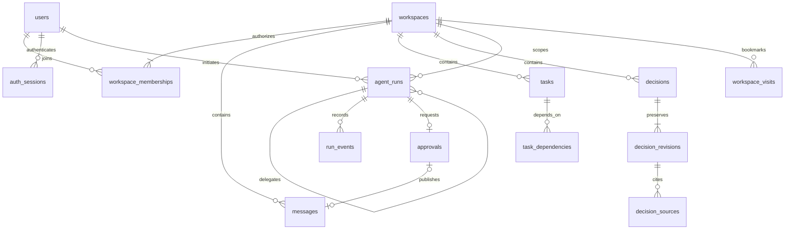
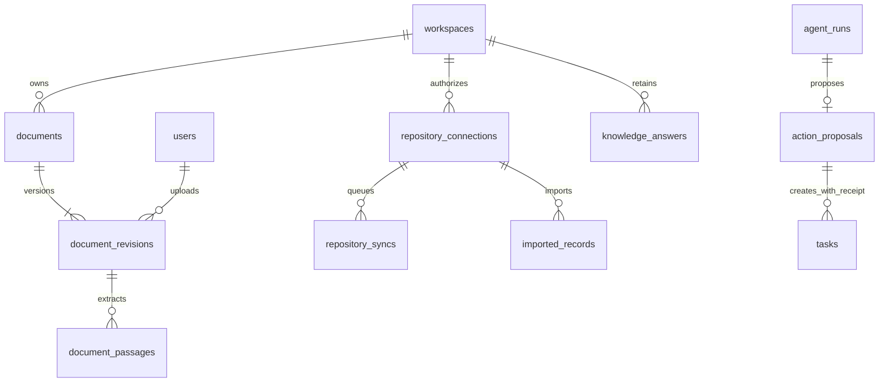

# Data model

Current Phase 10–12 behavior: [trained intelligence, selected evidence and operational hardening](INTELLIGENCE_HARDENING.md). Earlier milestone sections retain their historical scope.

All domain data belongs to a workspace. SQLAlchemy models are in `backend/models.py`; Alembic revisions are the only schema-change mechanism. SQLite enables foreign keys on every application connection. PostgreSQL 16 is exercised in CI. Timestamps are stored as timezone-naive UTC and serialized with a UTC offset.

## Existing collaboration records

Users have immutable IDs and separate password-hash credentials; display roles grant no privileges. Workspace ownership is recorded in `workspaces.owner_id` and the owner membership. A partial unique membership index limits a workspace to one owner. Application transactions preserve exactly one matching owner; migration 0003 refuses inconsistent existing ownership.

Messages and activity carry immutable actor/owner IDs. Invitations have immutable recipients, explicit terminal states, expiry and a partial unique pending-recipient index. Session IDs store only SHA-256 digests of random JWT identifiers. Tasks contain status/priority constraints, versions, assignee membership composite foreign keys, and archival rather than deletion. Dependency edges use same-workspace composite foreign keys and a non-self constraint; the service rejects cycles under a workspace lock.

## Decision provenance

`decisions` stores the current complete record, creator, version and nullable successor. Status/version checks and a same-workspace composite successor FK constrain it. Self-successors are rejected at the database; lifecycle rules prevent cycles in the API. `decision_revisions` is keyed by decision/version, contains the full structured snapshot, actor, reason and timestamp, and references its decision in the same workspace.

`decision_sources` is keyed by workspace, decision, revision, source kind and source ID, with a composite FK to the revision. It stores the cited preview and version. Its target is polymorphic: message/task/activity/decision existence and workspace equality are checked transactionally by the service, not by a polymorphic SQL FK. Application APIs never delete a cited source. Direct database edits require their own integrity review.

Indexes support workspace/update ordering for decisions and workspace/time ordering for revisions. Related tasks are task-kind decision source links; there is no duplicated task catalog.

## Continuity bookmarks

`workspace_visits` stores one monotonic `through` timestamp per workspace/user. It is an explicit acknowledgement of viewed changes, not an automatic last-login timestamp. A historical visit does not grant membership.

## Runs, events and approvals

`agent_runs` records stable contract ID, initiator, objective, optional same-workspace task/parent/retry, source references, request digest, state, attempt, lease, context snapshot, outcome and safe error code. Unique `(workspace, initiator, idempotency_key)` binds a request; nullable keys permit internal child runs. A unique retry predecessor prevents two retries of one failed attempt. Attempt constraints limit the chain to three.

Composite foreign keys prevent cross-workspace parent, retry and task links. Queue and workspace/creation indexes support workers and paginated history. `run_events` references a same-workspace run and stores bounded structured event details and time. Contract capabilities are code-defined/versioned, rather than user-controlled identity records or authorization roles.

Each run has at most one `approvals` record. It stores the exact action/payload/digest, current owner response, expiry, execution state and nullable unique message receipt. Its same-workspace run FK, action/state constraints, and unique receipt support atomic publication. Message insertion and execution completion occur in one transaction under the workspace lock; a committed receipt is distinct from an approval response.

## Migration and preservation

`0004_intelligence` adds seven tables and their indexes/constraints; it does not rewrite any Phase 1B table. Tests populate and compare users, credentials, workspaces, memberships, invitations, messages, tasks/dependencies, activity and sessions before/after upgrade, then repeat the migration. CI also tests populated PostgreSQL Phase 1B upgrades. Existing sessions remain valid across this migration; unlike 0003, 0004 does not force a new login.

Before upgrading user data, stop HTTP and worker writers, verify a native backup, and test a disposable copy. Startup refuses a mismatched revision. Downgrade is deliberately blocked; recovery uses a reviewed restore, not data deletion. See [Development](DEVELOPMENT.md).

## Connected knowledge and native actions (0005–0009)

`documents` has an optimistic current version and archive state. `document_revisions` preserves uploader, filename, title, content hash, durable state/lease and nullable raw bytes; its same-workspace FK and unique document/version prevent mixed ownership/duplicate revisions. `document_passages` stores stable revision/ordinal text with a composite same-workspace FK. Raw content becomes null after terminal extraction. Current visibility is enforced by joins to the ready revision and unarchived parent, not a stale client index.

`repository_connections` records public repository, creating owner, active state/version and workspace. Public mode contains no token; later private App fields hold encrypted expiring credentials, never browser-provided bearer tokens. `repository_syncs` records initiating owner, connection version, lease, bounded attempt/backoff, safe error and count. `imported_records` stores provider ID/type, original URL, current availability, bounded text, version/hash and timestamps; `(connection, provider_id)` is unique. Composite FKs enforce workspace/connection relationships. Stored older snapshots can remain unavailable without deleting history.

`knowledge_answers` stores question, mode/provider model, request idempotency, state, bounded claims and exact evidence reference fingerprints. Reads re-resolve evidence before displaying claims. No stored evidence snapshot bypasses source authorization/revocation.

`action_proposals` is separate from legacy `approvals`; its only enabled action is `create_task_plan`. The run FK is same-workspace and unique. Exact payload/hash, owner, expiry, state and JSON resource receipt support at-most-once execution under the workspace lock. The relationship to created tasks in the diagram represents immutable receipt IDs, not an additional task FK column. Task creation does not alter any existing task status.

`workspaces.knowledge_epoch` defaults to zero; generated `messages.knowledge_epoch` is nullable so preexisting/human messages retain compatibility. Run contexts bind an epoch in JSON. `worker_heartbeats` stores opaque worker ID, running/stopped state and last seen time; it is operational telemetry rather than workspace content.

The current schema head is `0018_sync_checkpoints`. Additive migrations preserve original columns/records, including completed publication receipts and existing sessions. SQLite populated Phase 1B and Phase 3 comparisons, repeated upgrades, FK checks, offline PostgreSQL DDL compilation and CI PostgreSQL execution protect migration compatibility. Destructive downgrades remain disabled.

## Additive pilot migrations (0010–0013)

- `0010_pdf_pages`: nullable `document_passages.page_number`; existing rows, IDs and original columns remain unchanged.
- `0011_retrieval_index`: bounded durable `retrieval_indexes` with workspace/creator, epoch/provider/model, state, JSON fingerprint/vector entries, lease and safe error metadata. APIs never return vectors/raw private context.
- `0012_private_github`: default public auth mode and nullable installation/repository IDs, encrypted credential and expiry/verification timestamps on existing connections; `github_authorizations` records session-bound device exchanges with encrypted pending secrets and terminal states.
- `0013_shared_limits`: `abuse_counters` with HMAC key, fixed-minute window and count, used by atomic SQLite/PostgreSQL upserts. This table is operational telemetry, not project history.

Populated Phase 6 upgrades compare every original column in every historical table before and after repeated upgrades, including ready passages and public connections. Fresh/repeated migrations, metadata drift and portable PostgreSQL DDL are checked. Existing document passages remain null-page; existing connections become explicitly public without acquiring any credential. Existing sessions and native receipts are preserved. Downgrades remain blocked.

## Additive Phase 10–12 migration chain

0014 adds index dimensions/options/timing/input/usage/attempt metadata and explicit extended run references. 0015 adds nullable email verification and hashed one-use recovery requests. 0016 adds nullable workspace closure and signed-plan retention receipts. 0017 binds saved answers to retrieval mode/evidence scope, defaulting old answers to lexical. 0018 adds successful repository reconciliation checkpoints. No upgrade deletes content, clears credentials, verifies old email addresses or closes workspaces. Existing-record migration tests compare the original columns before and after upgrade; historical seed fixtures use historical-schema SQL rather than new ORM columns.
