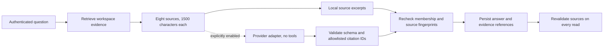

# Connected knowledge and grounded answers

Current Phase 10–12 implementation, setup, verification and limits: [trained intelligence and operational hardening](INTELLIGENCE_HARDENING.md). Earlier milestone sections below describe their original scope.

Parallel keeps native tasks/decisions, uploaded passages, imported GitHub records and generated interpretations distinct. Everything is retrieved inside an authenticated workspace. No external write capability is enabled.

## Local documents

Documents accepts UTF-8 `.txt`, `.md` and extractable-text `.pdf` files through the real upload form. The API accepts base64 JSON, validates the filename/extension and decoded size, and queues durable extraction. Filenames are metadata, never filesystem paths. Markdown is displayed as text; embedded HTML, links and instructions are not executed. PDFs require a matching `%PDF-` signature and are parsed in a subprocess using pinned pypdf. OCR, attachment extraction and arbitrary URLs are unsupported.

Bounds are 512 KiB per upload, 200,000 extracted characters, 200 documents per workspace, 50 revisions per document and 20 queued/processing revisions per workspace. The HTTP layer rejects bodies above 800,000 bytes before JSON parsing, including chunked requests. These bounds also apply to authenticated users.

The worker claims a random 30-second lease, normalizes UTF-8 text or extracts PDF pages, rejects unsafe/empty content and creates paragraph-aware nonoverlapping passages of at most 1,200 characters. IDs derive deterministically from revision ID and ordinal. Each revision preserves its uploader, filename, title, hash and state. Raw bytes are discarded on success, failure or cancellation. Invalid encoding/empty content/limits fail visibly; users can explicitly re-upload a new revision. Expired processing leases fail rather than pretending extraction succeeded.

Identical active current content reuses its existing document, rather than creating a duplicate. Revision upload requires the current document version. Default search includes only the current ready revision; explicit historical search can retrieve earlier ready passages. Archiving uses an optimistic version and immediately denies **all** passages, including history and direct IDs. Pending extraction is cancelled and a late worker cannot publish it. Archived records are retained, not hard-deleted.

## Public GitHub connector

Set `GITHUB_CONNECTOR_ENABLED=true` on both HTTP and worker processes, then restart them. In Connections, a workspace owner enters `owner/repository` and explicitly authorizes public read-only imports. The default is disabled. Members can inspect imported context; only the current owner can connect, sync or revoke. Public mode remains unauthenticated with no credential fallback. Private authorization is a separate explicit GitHub App flow below; neither mode writes to repositories.

The production adapter makes exactly three fixed-host HTTPS GET requests: repository metadata, the first page of up to 25 recently updated issues, and up to 25 recently updated pull requests. It does not follow provider-supplied URLs, pagination links or redirects. The list is a bounded recent window, **not a complete repository mirror**. PR entries returned by the issues endpoint are omitted there to avoid duplicate issue/PR interpretation. Original links are constructed for the validated repository and numeric issue/PR number.

The adapter uses the official JSON media type, User-Agent and explicit API version `2026-03-10`, with a maintained CA bundle and certificate verification. Each request has an eight-second socket timeout and a one-megabyte response cap. The durable sync lease is 45 seconds; late responses cannot commit. A socket deadline is not a hard operating-system DNS deadline, so worker supervision remains necessary.

Sync insertion reuses pending work; explicit syncs have a five-minute cooldown. Jobs have at most three automatic attempts and respect provider Retry-After/reset delays; delays beyond one day fail visibly rather than retrying early. Authentication/private/not-found/redirect responses are failures, not empty successful syncs. Workspace limits are 20 connection records and 2,000 retained imported records. Upserts use `(connection, provider_id)` and content hashes. Records outside the latest bounded snapshot become unavailable to retrieval; stored history is retained. These snapshots do not claim GitHub-side deletion.

Before saving, the worker rechecks the initiating user's current ownership, active connection/version and lease. Revocation cancels queued/in-flight work and blocks all imported source resolution. Imported text is labeled untrusted, preserves original links and never updates native task or decision status.

**Verification:** the public adapter was exercised against `Yug-More/Parallel-AI` using three unauthenticated GET requests, returning repository/PR records. Backend and browser connector failure/revocation tests use explicitly synthetic provider fixtures. Those fixtures do not establish live authentication, private access or model compatibility.

API behavior follows [GitHub REST guidance](https://docs.github.com/en/rest/using-the-rest-api/getting-started-with-the-rest-api) and [rate-limit handling](https://docs.github.com/en/rest/using-the-rest-api/rate-limits-for-the-rest-api).

## Extractable PDFs

The existing 512 KiB / 200,000-character bounds apply to PDFs, plus 30 pages. Extraction receives bytes through stdin, never a filename or URL, in `python -I` with no shell and a minimal environment. The parent kills/reaps the child after eight seconds. Unix CPU limit is four seconds; Linux additionally limits address space to 512 MiB. macOS cannot reliably lower its reserved address space and therefore relies on CPU/deadline/input/output limits; Windows workers should use Linux containers. This is resource isolation, not a complete filesystem/network sandbox. pypdf does not execute embedded scripts or fetch links/attachments.

Malformed, encrypted, image-only/empty, oversized and page-limit failures expose safe codes. New passages retain one-based page numbers; old text passages retain null page numbers in storage and omit page metadata from source JSON, preserving existing fingerprints and IDs. Revision/hash deduplication, history and archive invalidation reuse the existing lifecycle. Archive is the supported application removal operation; physical deletion/retention is not implemented. See [pypdf extraction limits](https://pypdf.readthedocs.io/en/stable/user/extract-text.html).

## Selected private GitHub repositories

GitHub Apps were chosen over broad OAuth `repo` scopes because App user tokens intersect user access with selected installation repositories and fine-grained permissions. A user token is OAuth-backed, but this application implements **GitHub App device flow**, not a general OAuth-app integration. See [official authorization flow](https://docs.github.com/en/apps/creating-github-apps/authenticating-with-a-github-app/generating-a-user-access-token-for-a-github-app).

Operator configuration (server and worker only):

1. Register a GitHub App yourself; no external app was created by this implementation. Enable device flow and expiring user access tokens. Grant only repository **Metadata: read**, **Issues: read**, **Pull requests: read**; no organization/account/contents/write permissions. Install on **selected repositories**. Broad/all-repository or write-capable installations are rejected.
2. Set `GITHUB_CONNECTOR_ENABLED=true`, `GITHUB_APP_ENABLED=true`, `GITHUB_APP_ID`, `GITHUB_APP_CLIENT_ID`, `GITHUB_APP_CLIENT_SECRET`, and `CREDENTIAL_ENCRYPTION_KEY`. Generate the separate key with `python -c 'from cryptography.fernet import Fernet; print(Fernet.generate_key().decode())'`. Store it privately outside Git/Vite. Missing/invalid required configuration fails startup.
3. Back up this key securely with access controls separate from the database. Losing it requires reauthorization; changing it does not migrate ciphertext. No unattended key rotation is implemented. Database text remains unencrypted except credential/device-grant envelopes.
4. A current workspace owner enters the exact repository and installation ID in Connections, starts authorization, enters the displayed code at the fixed GitHub device URL, then checks authorization. Pending codes survive refresh via an owner-only authenticated endpoint. No token is accepted in a browser form. Five starts per workspace/hour and provider polling intervals apply.

The server verifies App ID, selected/read-only installation, accessible repository ID and name before mapping it to the workspace. Device secrets and access/refresh tokens are Fernet-encrypted; terminal device grants are cleared. Tokens must expire within eight hours and carry a refresh token. Renewal rechecks current authority and persists rotated credentials before later reads. No credential is included in normal response objects/logs/fixtures/commits.

Private syncs revalidate installation permissions and selected repository access every time. They read metadata and up to three complete pages plus a partial fourth page (at most 99 records per category); a full fourth page fails `pagination_capacity` rather than committing an incomplete snapshot. Upserts are incremental by stable provider ID/hash; network reads are bounded full snapshots, not cursor-based deltas. Responses never dictate endpoints, redirects or original URLs. Maximum response is 1 MB and socket timeout eight seconds; private lease is 120 seconds. The application never writes to GitHub; POST is restricted to device/token authentication endpoints.

The worker schedules explicitly authorized private connections every five minutes. Evidence is valid for ten minutes after verification; failed renewal, removed access, changed repository identity or creator ownership fail closed. On the next authorized request or worker poll, expired grants invalidate the connection and knowledge epoch, hiding sources, saved answers and older derived reports. External access changes can remain visible until the next verification or the ten-minute deadline; there is no webhook/immediate remote-revocation guarantee. Stopped workers eventually make private connections expire, requiring reauthorization. Local revocation clears stored credentials/cancels syncs; revoke the App grant in GitHub separately when desired. Native human-authored quotations cannot be recalled.

Private authorization, expiry/renewal, pagination, access loss and revocation use synthetic transports in tests. **No live private repository grant, external App registration or paid call was performed.** Public live-read verification from Phase 4 remains separate.

## Optional local index and provider abstraction

`LOCAL_INDEX_ENABLED=true` exposes an explicit Build local passage index action. Durable jobs bind workspace epoch/provider/model, claim a 20-second lease, index at most 200 current document passages and validate finite bounded vectors. Raw text is not duplicated into index entries. The worker discards stale/late results; each read re-resolves every source and fingerprint. The lexical path remains available without an index or credentials; filters/offsets that the index cannot safely preserve fall back.

`EmbeddingProvider` is a replaceable interface. The shipped `local-ngram / char3-sha256-128-v1` adapter is deterministic character similarity, **not trained semantic embeddings**. `ranking=hybrid` explicitly combines its candidates with lexical ranking through reciprocal-rank fusion. This infrastructure and fallback are tested; semantic quality, multilingual understanding and external embedding adapters are unverified/unimplemented. No model downloads, network embedding calls or vector database are introduced.

## Grounded answers

Ask workspace works without model credentials. Extractive mode retrieves at most eight authorized current sources and shows bounded quotations with navigable citations. This is evidence finding, not an asserted answer to every question. Lexical matches can be incomplete or contradictory; no matches produce abstention. Decision revisions remain explicitly historical source kinds rather than current decisions.

Optional model mode additionally requires `pip install -r requirements-ai.txt`, `OPENAI_API_KEY`, `OPENAI_MODEL`, and **`GROUNDED_MODEL_ENABLED=true`**. Users explicitly choose model mode; setting a conversation key alone does not enable it. Real calls can incur cost. Never put provider keys into Vite configuration.

The model adapter receives at most 12,000 body characters plus bounded titles/question/metadata, requests strict structured claims (`fact`/`inference`, text and citation IDs), has no tools, makes one request with a 20-second client timeout, at most 1,600 output tokens and no automatic retry, and requests `store=false`. Local validation rejects unknown citations, malformed/oversized output and uncited claims. The configured model identifier is retained. Empty claims abstain; provider errors are sanitized and saved as failures. The provider function is replaceable behind the same bounded contract; the supplied implementation is OpenAI, not a claim of tested multi-provider compatibility. See [Structured outputs](https://developers.openai.com/api/docs/guides/structured-outputs).

A valid citation ID does **not** prove semantic entailment, factual correctness or prompt-injection immunity. Model output stays visibly labeled interpretation. Provider behavior was tested with fake adapters only; no paid model call or live model-quality claim is included.

Answers save exact evidence fingerprints and references. Each read resolves all evidence again; any change, archive or revocation hides the entire answer. Model latency holds no workspace lock; membership/evidence are rechecked afterward. Idempotency keys prevent repeated calls for the same request; abandoned processing records become visibly interrupted after two minutes. New questions are limited to ten per workspace per minute. Answer history currently shows the latest 20 records.

## Derived-report revocation

Document changes and changed/revoked imports advance a workspace knowledge epoch. Agent context capture binds that epoch. Context research labels current versus prior decision/document revisions; planning reports existing blockers/readiness and accepted decisions alongside explicit objective steps. After an epoch change, saved run context/outcomes, exact publication previews and generated conversation messages from older epochs are hidden from APIs/search/model context. This deliberately hides unrelated reports too: conservative invalidation favors confidentiality over availability. Request a fresh run after context changes.

Decision-source previews/history redact unavailable generated-message evidence. Human-authored decision fields, tasks and messages remain authored records; manually copying a passage into native text cannot be automatically reversed. Revocation cannot erase already downloaded responses or screenshots. Database administrators/backups can still access retained raw history; encryption at rest and retention policies remain operational responsibilities.

Optional `POST /workspaces/{w}/runs/{id}/reasoning` reuses a 3–200-character objective as an explicit current-evidence model question and saves a separately cited answer. The Agents UI exposes this only when model mode is configured. It never modifies run outcomes, proposals or tasks. Structured claims and citation allowlists constrain output shape, not truth or prompt-injection immunity; [official structured-output guidance](https://developers.openai.com/api/docs/guides/structured-outputs) and [untrusted-data guidance](https://developers.openai.com/api/docs/guides/agent-builder-safety) inform this boundary. Lexical negation-overlap warnings flag possible conflict without resolving it. The shared model budget is 30 requests/minute across HTTP processes using the same database/signing secret, plus existing workspace answer quotas; configure provider-side spend caps separately.

For the private connector pagination bound, a full fourth page intentionally fails rather than silently truncating. Operators with larger repositories must wait for a separately reviewed cursor/full-reconciliation design. The public connector retains its existing first-page snapshot semantics. A refresh failure or unavailable encryption key can require a fresh owner authorization; neither path falls back to public/CLI access.

## Current private permission and sync controls

The owner can explicitly revalidate an existing selected GitHub App connection without fetching repository content. A failed permission/identity check revokes the connection. External model transmission requires a permission check within thirty seconds; ordinary cached reads still expire after ten minutes. This residual window and the live owner-run verification harness are documented in [hardening](INTELLIGENCE_HARDENING.md).

Successful full snapshots now record atomic reconciliation checkpoints: connection version, committed time and created/updated/unavailable/unchanged counts. Failures leave the last success intact. Stable upserts avoid revising unchanged records. This does not implement GitHub remote delta streaming or page-resume cursors. No second decorative connector or repository write capability was added.
