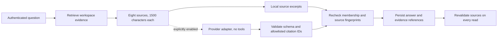

# Connected knowledge and grounded answers

Parallel keeps native tasks/decisions, uploaded passages, imported GitHub records and generated interpretations distinct. Everything is retrieved inside an authenticated workspace. No external write capability is enabled.

## Local documents

Documents accepts UTF-8 `.txt` and `.md` files through the real upload form. The API accepts base64 JSON, validates the filename/extension and decoded size, and queues durable extraction. Filenames are metadata, never filesystem paths. Markdown is displayed as text; embedded HTML, links and instructions are not executed. PDF, OCR, attachments and arbitrary URLs are not supported.

Bounds are 512 KiB per upload, 200,000 extracted characters, 200 documents per workspace, 50 revisions per document and 20 queued/processing revisions per workspace. The HTTP layer rejects bodies above 800,000 bytes before JSON parsing, including chunked requests. These bounds also apply to authenticated users.

The worker claims a random 30-second lease, normalizes UTF-8 text, rejects binary/control content and creates nonoverlapping passages of at most 1,200 characters. IDs derive deterministically from revision ID and ordinal. Each revision preserves its uploader, filename, title, hash and state. Raw bytes are discarded on success, failure or cancellation. Invalid encoding/empty content/limits fail visibly; users can explicitly re-upload a new revision. Expired processing leases fail rather than pretending extraction succeeded.

Identical active current content reuses its existing document, rather than creating a duplicate. Revision upload requires the current document version. Default search includes only the current ready revision; explicit historical search can retrieve earlier ready passages. Archiving uses an optimistic version and immediately denies **all** passages, including history and direct IDs. Pending extraction is cancelled and a late worker cannot publish it. Archived records are retained, not hard-deleted.

## Public GitHub connector

Set `GITHUB_CONNECTOR_ENABLED=true` on both HTTP and worker processes, then restart them. In Connections, a workspace owner enters `owner/repository` and explicitly authorizes public read-only imports. The default is disabled. Members can inspect imported context; only the current owner can connect, sync or revoke. There is no OAuth flow, private-repository support, browser token, stored account credential or GitHub write operation.

The production adapter makes exactly three fixed-host HTTPS GET requests: repository metadata, the first page of up to 25 recently updated issues, and up to 25 recently updated pull requests. It does not follow provider-supplied URLs, pagination links or redirects. The list is a bounded recent window, **not a complete repository mirror**. PR entries returned by the issues endpoint are omitted there to avoid duplicate issue/PR interpretation. Original links are constructed for the validated repository and numeric issue/PR number.

The adapter uses the official JSON media type, User-Agent and explicit API version `2026-03-10`, with a maintained CA bundle and certificate verification. Each request has an eight-second socket timeout and a one-megabyte response cap. The durable sync lease is 45 seconds; late responses cannot commit. A socket deadline is not a hard operating-system DNS deadline, so worker supervision remains necessary.

Sync insertion reuses pending work; explicit syncs have a five-minute cooldown. Jobs have at most three automatic attempts and respect provider Retry-After/reset delays; delays beyond one day fail visibly rather than retrying early. Authentication/private/not-found/redirect responses are failures, not empty successful syncs. Workspace limits are 20 connection records and 2,000 retained imported records. Upserts use `(connection, provider_id)` and content hashes. Records outside the latest bounded snapshot become unavailable to retrieval; stored history is retained. These snapshots do not claim GitHub-side deletion.

Before saving, the worker rechecks the initiating user's current ownership, active connection/version and lease. Revocation cancels queued/in-flight work and blocks all imported source resolution. Imported text is labeled untrusted, preserves original links and never updates native task or decision status.

**Verification:** the public adapter was exercised against `Yug-More/Parallel-AI` using three unauthenticated GET requests, returning repository/PR records. Backend and browser connector failure/revocation tests use explicitly synthetic provider fixtures. Those fixtures do not establish live authentication, private access or model compatibility.

API behavior follows [GitHub REST guidance](https://docs.github.com/en/rest/using-the-rest-api/getting-started-with-the-rest-api) and [rate-limit handling](https://docs.github.com/en/rest/using-the-rest-api/rate-limits-for-the-rest-api).

## Grounded answers

Ask workspace works without model credentials. Extractive mode retrieves at most eight authorized current sources and shows bounded quotations with navigable citations. This is evidence finding, not an asserted answer to every question. Lexical matches can be incomplete or contradictory; no matches produce abstention. Decision revisions remain explicitly historical source kinds rather than current decisions.

Optional model mode additionally requires `pip install -r requirements-ai.txt`, `OPENAI_API_KEY`, `OPENAI_MODEL`, and **`GROUNDED_MODEL_ENABLED=true`**. Users explicitly choose model mode; setting a conversation key alone does not enable it. Real calls can incur cost. Never put provider keys into Vite configuration.

The model adapter receives at most 12,000 body characters plus bounded titles/question/metadata, requests strict structured claims (`fact`/`inference`, text and citation IDs), has no tools, makes one request with a 20-second client timeout, at most 1,600 output tokens and no automatic retry, and requests `store=false`. Local validation rejects unknown citations, malformed/oversized output and uncited claims. The configured model identifier is retained. Empty claims abstain; provider errors are sanitized and saved as failures. The provider function is replaceable behind the same bounded contract; the supplied implementation is OpenAI, not a claim of tested multi-provider compatibility. See [Structured outputs](https://developers.openai.com/api/docs/guides/structured-outputs).

A valid citation ID does **not** prove semantic entailment, factual correctness or prompt-injection immunity. Model output stays visibly labeled interpretation. Provider behavior was tested with fake adapters only; no paid model call or live model-quality claim is included.

Answers save exact evidence fingerprints and references. Each read resolves all evidence again; any change, archive or revocation hides the entire answer. Model latency holds no workspace lock; membership/evidence are rechecked afterward. Idempotency keys prevent repeated calls for the same request; abandoned processing records become visibly interrupted after two minutes. New questions are limited to ten per workspace per minute. Answer history currently shows the latest 20 records.

## Derived-report revocation

Document changes and changed/revoked imports advance a workspace knowledge epoch. Agent context capture binds that epoch. Context research labels current versus prior decision/document revisions; planning reports existing blockers/readiness and accepted decisions alongside explicit objective steps. After an epoch change, saved run context/outcomes, exact publication previews and generated conversation messages from older epochs are hidden from APIs/search/model context. This deliberately hides unrelated reports too: conservative invalidation favors confidentiality over availability. Request a fresh run after context changes.

Decision-source previews/history redact unavailable generated-message evidence. Human-authored decision fields, tasks and messages remain authored records; manually copying a passage into native text cannot be automatically reversed. Revocation cannot erase already downloaded responses or screenshots. Database administrators/backups can still access retained raw history; encryption at rest and retention policies remain operational responsibilities.
