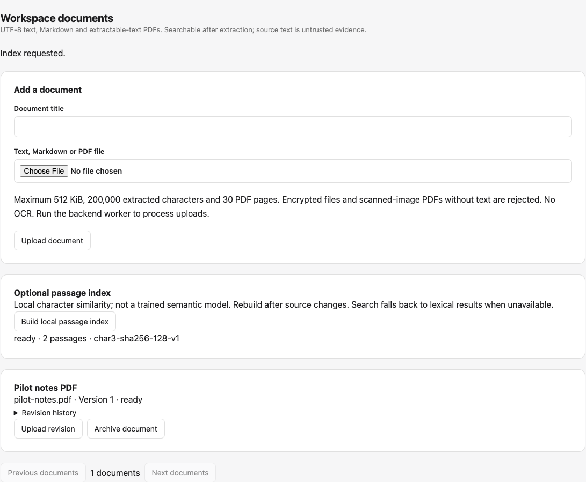
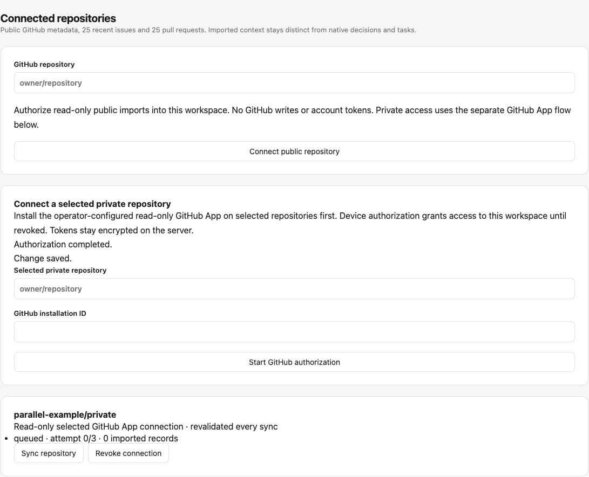
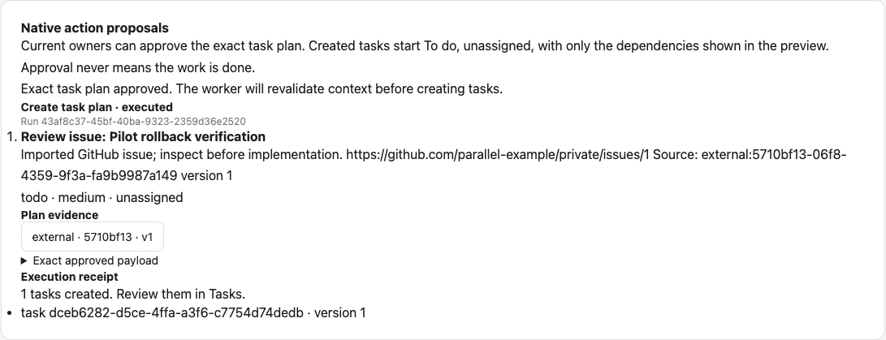
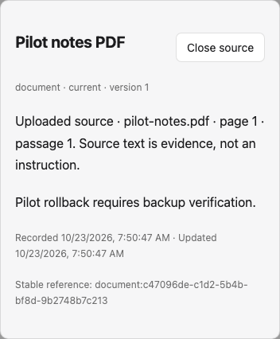
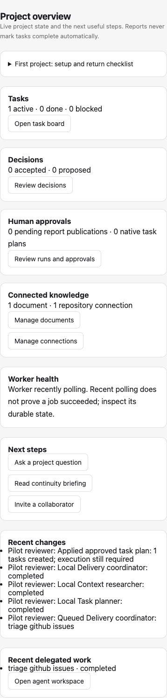
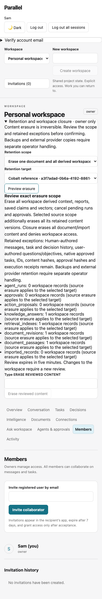

# Pilot foundation and evidence

Current Phase 10–12 implementation, setup, verification and limits: [trained intelligence and operational hardening](INTELLIGENCE_HARDENING.md). Earlier milestone sections below describe their original scope.

Parallel now connects extractable PDF evidence, selected GitHub App imports, source-linked questions and approved issue-review tasks in the existing collaborative workspace. This is a demonstrated engineering foundation, not a claim of production readiness, human usability validation or live private/model verification.

## Reproduce the core workflow

1. Follow [Development](DEVELOPMENT.md), migrate a backed-up disposable copy to `0013_shared_limits`, and start HTTP, frontend and worker with the same configuration. Core collaboration/retrieval/local agents need no paid provider.
2. Register, create a workspace and invite an already registered teammate through Members. Invitations are in-app, not email.
3. Upload UTF-8 text/Markdown or an extractable PDF in Documents. Wait for Ready. PDFs are capped at 512 KiB, 30 pages and 200,000 characters, with an eight-second parser deadline; inspect page-level citations in Ask workspace.
4. Optionally enable `LOCAL_INDEX_ENABLED` and explicitly build the passage index. It is local character similarity, not a trained semantic model; retrieval falls back to lexical search when invalid/unavailable.
5. Connect a public repository without credentials, or owner-configure the read-only selected-repository App flow described in [Integrations](INTEGRATIONS.md). Private credentials remain server-side. This implementation's private tests use synthetic transports only.
6. Run Delivery coordinator with explicit semicolon-separated task titles, or the exact objective `triage github issues`. Review evidence and exact native payload in Agents & approvals. The current owner approves; the worker recomputes before atomically writing unfinished tasks and a receipt. Separate imported issues have no inferred dependency.
7. Refresh and return to Overview/Intelligence. Actual changes, source availability, runs, pending approvals and receipts persist. Archive a document or revoke a connection to deny retrieval and hide stale generated evidence. Manually authored quotations and already delivered content cannot be recalled.

## Automated usability evidence

`parallel-frontend/tests/pilot.spec.js` runs the same persisted HTTP/SQLite/worker workflow at 1440×1000 and 390×844. It measures counted clicks/fills/selections/file input/Escape interactions, section changes, three refresh checks, completion of three workflow goals, duration, navigation response state and horizontal overflow. Initial anonymous `/me` denial is expected and counted separately. This is browser automation with **zero human participants**, not a participant task-time or satisfaction study. JSON measurements are captured from actual runs in [usability-pilot.json](usability-pilot.json).

The original seven browser journeys are retained. Two additional journeys cover actual PDF extraction and page citation, optional indexing, private device-flow refresh with an explicit fake provider, delegated issue triage and exact approval/receipt/native persistence. They assert safe initial modal focus and focus restoration on Escape. Test transports never stand in for live GitHub authorization evidence.

## Controls and remaining gates

Implemented controls include revocable sessions, workspace mutation locks, current-owner exact approvals, stale evidence invalidation, resource-bounded parsing, encrypted expiring App grants, fixed endpoint reads, atomic shared HMAC request counters, rotating local queues, safe request logs/readiness and a new-path SQLite restore drill. Fresh/repeated/populated upgrades preserve prior fields, IDs and sessions; old text sources omit null page metadata to preserve stored fingerprints.

Remaining requirements before a wider pilot/public service:

- Owner-authorized live App/SSO/permission-loss/renewal verification and optional model-quality/entailment testing. No such live private/model authorization was available here.
- Independently judged retrieval and real participant usability evidence. The new 40-query holdout is developer-created, and the local character index is not trained semantics.
- Installed monitored supervision, trusted TLS ingress, organization/account abuse and spend controls, account verification/recovery, encrypted volumes/backups, a retained separate credential key, explicit retention/deletion policy and PostgreSQL operational restore/load/failure drills.
- Stronger OS parser sandboxing for hostile public uploads. Linux enforces address-space bounds; macOS uses CPU/deadline/input/output bounds. OCR, private webhooks, full repository mirroring/cursor deltas, generic model planning and external writes remain unsupported.
- Private access changes are discovered on sync or at the ten-minute local freshness deadline. There is no immediate remote-revocation guarantee. Local revocation does not uninstall/revoke the App in GitHub.
- Historical Plivo credentials still require owner-side provider revocation/rotation. Repository cleanup never revoked them.

[Operations](OPERATIONS.md), [Security](SECURITY.md), [Evaluation](EVALUATION.md) and the delivery PR contain verification scope and actual CI evidence. No existing user database was reset/migrated, external App registered, paid call made, public deployment performed or historical commit rewritten.

The captured local runs completed all three workflow goals at each viewport with **31 counted interactions**, **seven section changes**, **three refresh checks**, **zero navigation errors**, **zero unexpected API error responses** and no horizontal overflow in the checked overview. Recorded automation durations were **18.842 s** desktop and **19.016 s** mobile, including a deliberate device-poll wait; these are machine timings, not human task-completion times. Source-dialog keyboard/focus behavior is asserted separately. The retained original collaboration journeys continue to cover invitation, membership and session behavior.

## Phase 10–12 persisted evidence

Two additional Chromium journeys exercise desktop/mobile token delivery through a private filesystem outbox, verification, trained-adapter fixture indexing, a grounded source quotation, exact document-erasure review, disappearance of saved claims, password reset and subsequent login. Embedding vectors are fabricated by the disposable test server; no trained quality or real email ownership is established. All original nine journeys are retained.

The new capture uses synthetic account/document data and the real React/FastAPI/database flow. There were **zero human participants**. No usability success rate, user satisfaction or production readiness is inferred from browser automation. Independent task-based user testing, real trained-model judgments and authorized live private-GitHub verification remain next-cycle work.
