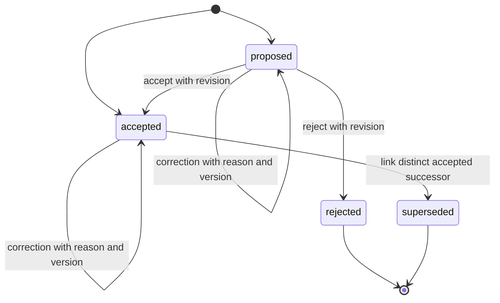
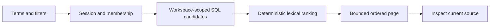

# Project continuity

Parallel connects persisted conversation, tasks, decisions and activity. It offers deterministic source retrieval and a change briefing, not an LLM-generated memory of everything the team has done.

## Records and authority

- Messages are raw human or assistant text. Assistant messages are explicitly marked as interpretations, including published local-agent reports.
- Tasks describe current assigned work, dependencies, archival and version. A report does not change task completion.
- Decisions are human-maintained structured records with context, statement, rationale, alternatives and tradeoffs. Accepted status expresses the team's choice, not independently established truth.
- Activity records attribute actual mutations to immutable human IDs.
- Briefings and local reports are derived views. Their time, scope and sources are inspectable. They do not become accepted decisions automatically.

## Decision lifecycle

`POST /workspaces/{w}/decisions` records a proposed/accepted decision. `PATCH /decisions/{id}` takes the full editable record, current `version`, and nonempty `reason`; stale edits return 409. No-op saves do not append history. Rejected and superseded records are terminal. Accepted decisions cannot be demoted to proposed/rejected; correct them with a reason or supersede them.

`POST /decisions/{id}/supersede` requires both current versions and an accepted successor in the same workspace. It saves a revision and preserves the original reasoning. Chains remain navigable; a terminal decision cannot be used as a successor. `GET /decisions/{id}/history` returns paginated snapshots.

## Provenance

A decision accepts at most 30 `{kind,id}` sources: `message`, `task`, `activity`, or `decision`. Linked tasks provide task relationships as well as evidence. The server resolves every identifier in the authorized workspace. Self-citation and duplicate references are rejected. A source reference confers no access to another workspace.

Each revision stores a bounded cited preview (up to 2,000 characters) and source version. Current detail shows that preview alongside live source state. History preserves the cited preview even after task edits or archival. The source viewer opens the full current record. There is no source hard-delete API; archival remains visible when explicitly included. No preview asserts that an earlier claim is still current.

## Retrieval

`GET /workspaces/{w}/knowledge` supports `q`, `kind`, `status`, `since`, `until`, `include_historical`, `include_archived`, `limit` (1–100), and `offset` (0–10,000). Timestamps must include a timezone. Since is exclusive and until inclusive, applied to update time for decisions/tasks and creation time for messages/activity.

Default `ranking=coverage` removes a small explicit set of common question words and requires at least 60% of the remaining terms (rounded up) to match title/body. A title term scores 3, body term 1; a complete title phrase adds 4. `ranking=legacy` preserves the original OR candidate method for comparisons. Stopword-only nonempty questions abstain. Up to 12 unique terms and 200 query characters are used. Ties sort by event time descending, kind, then ID. Default decision results exclude superseded/rejected records; default task results exclude archives. A status filter does not override those defaults: enable historical/archive inclusion explicitly.

Every result carries a stable reference, version where applicable, event time, state, authority category, and excerpt. Empty results say no matching evidence. This is lexical retrieval; synonyms and paraphrases can be missed. Coverage matching can still return irrelevant neighbors and miss partial/vocabulary matches. It is not semantic search, contradiction resolution, or an arbitrary question-answering system. [Evaluation](EVALUATION.md) measures those limits.

## Continuity briefing

`GET /workspaces/{w}/continuity` uses an explicit `since` or the authenticated user's saved visit. First visits show available history. Reading never advances the visit marker. **Mark caught up** posts the briefing's retrieval time to `/continuity/visit`; the server rejects future markers and only moves a marker forward.

The briefing separates live task/decision counts from time-bounded source changes, decision revision events and attributed activity. It also includes active tasks explicitly Blocked or waiting on unfinished prerequisites, and the count of unexpired pending approvals. Each list is bounded and paginated. The frontend offers a local-time timestamp input and displays event time separately from retrieval time.

The change interval ends at the server's retrieval timestamp. Counts are current reads, not a historical point-in-time reconstruction. Task sources show their latest state; revision events retain the historical decision snapshot. A deleted membership prevents subsequent reads, source resolution, and worker commits. Rejoining restores workspace access to its history; already-known information cannot be retracted.

## Optional models

The existing conversation reply adapter remains optional and separately scoped. Retrieval, briefing, coordinator and approval flows make no model calls and require no provider credentials. Ask workspace adds local quotations plus a separately enabled bounded model mode, described in [Integrations](INTEGRATIONS.md). There is no claim that live model-backed evidence synthesis or embedding retrieval has been verified.

## Connected source lifecycle

Search/source navigation also supports `document`, `external` and explicitly historical `decision_revision` IDs (`decision_id@version`). Default document search selects the current ready revision; historical inclusion exposes prior ready revisions only while the parent is active. Archived documents and revoked/unavailable imports remain inaccessible even with archive/history flags. Imported records retain original GitHub links and an untrusted-import authority category.

Research/answers can cite these sources. Human decision-source editing still accepts the original four native types; importing a document does not automatically promote it into an accepted decision. Generated report messages can be cited, but their snapshots are redacted if the underlying knowledge epoch becomes unavailable. Saved answers check exact evidence fingerprints on every read. [Integrations](INTEGRATIONS.md) describes conservative revocation and authored-record limitations.
